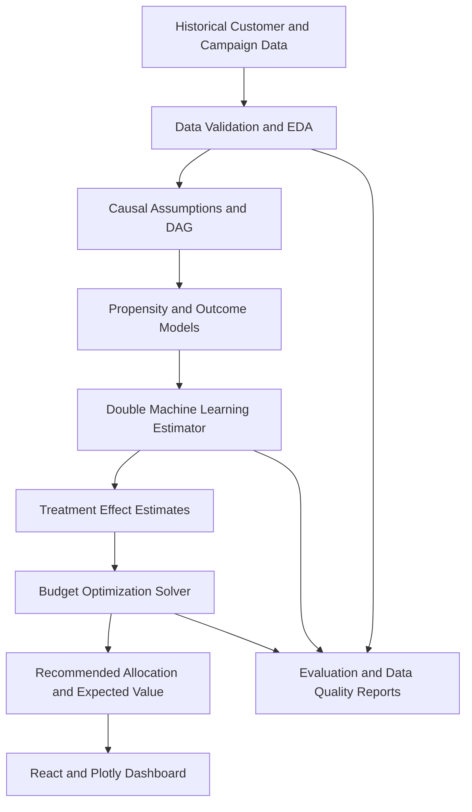

# EconoCausal: Dynamic Pricing via Double Machine Learning

> **A causal machine-learning decision-support platform for estimating
> the incremental impact of discounts and allocating a limited marketing
> budget to customers most likely to change their behavior because of an
> offer.**

**Domain:** Economics, Causal AI, Data Science & Machine Learning\
**Project reference:** ITS/DSML/1147\
**Status:** In development\
**Repository:** [Krishna8208863439/EconoCausal](https://github.com/Krishna8208863439/EconoCausal)

------------------------------------------------------------------------

## Table of Contents

- [1. Project Overview](#1-project-overview)
- [2. Problem Statement](#2-problem-statement)
- [3. Objectives](#3-objectives)
- [4. Why Causal ML and Double Machine Learning?](#4-why-causal-ml-and-double-machine-learning)
- [5. Proposed Solution](#5-proposed-solution)
- [6. Key Features and Modules](#6-key-features-and-modules)
- [7. System Architecture](#7-system-architecture)
- [8. Methodology and Workflow](#8-methodology-and-workflow)
- [9. Dataset Design](#9-dataset-design)
- [10. Technology Stack](#10-technology-stack)
- [11. Repository Structure](#11-repository-structure)
- [12. Implementation Plan](#12-implementation-plan)
- [13. Evaluation Strategy](#13-evaluation-strategy)
- [14. Running the Project](#14-running-the-project)
- [15. API Design (Proposed)](#15-api-design-proposed)
- [16. Dashboard Screens](#16-dashboard-screens)
- [17. Responsible Use and Limitations](#17-responsible-use-and-limitations)
- [18. Expected Deliverables](#18-expected-deliverables)
- [19. Future Enhancements](#19-future-enhancements)
- [20. References](#20-references)
- [21. Author](#21-author)

------------------------------------------------------------------------

## 1. Project Overview

EconoCausal explores how **Causal Machine Learning (Causal ML)** and
**Double Machine Learning (DML)** can support smarter promotional
pricing. Instead of simply predicting which customers are likely to
purchase, the system aims to estimate how much a particular customer's
purchase outcome may change when they receive a discount.

The platform is designed around three connected components:

1. **Causal inference engine** --- estimates the Individual Treatment
   Effect (ITE) of a promotional offer.
2. **Budget optimization engine** --- recommends discount allocations
   under a fixed marketing budget.
3. **Interactive dashboard** --- helps a marketing analyst inspect
   uplift, compare strategies, and review recommended allocations.

The project follows the assigned brief's use case: a marketing director
has a fixed promotional budget and wants to focus spending on customers
whose behavior is likely to change because of a discount.

> **Important:** This repository describes the intended design. Model
> performance, business savings, and causal effects must be established
> by experiments on suitable data; they should not be assumed before
> evaluation.

## 2. Problem Statement

Traditional predictive machine-learning models learn patterns associated
with an outcome. A customer predicted to have a high probability of
leaving or not purchasing is not necessarily a customer whose behavior
will change after receiving a discount.

For example, a customer might purchase with or without a coupon. Giving
that customer a discount may create little incremental value. Another
customer may purchase only when an offer is provided. The second
customer may produce greater incremental value from the promotion.

EconoCausal addresses the following question:

**"For which customers is a discount expected to change the outcome, and
how should a limited promotional budget be allocated?"**

The system estimates treatment effects from observational or
experimental data and uses those estimates in a budget-constrained
allocation process. Causal estimates depend on data quality and
assumptions; observational data alone cannot guarantee that every
confounder has been removed.

## 3. Objectives

- Understand and prepare customer, campaign, treatment, and outcome data.
- Perform exploratory data analysis (EDA) and document data quality.
- Build a causal graph (Directed Acyclic Graph, or DAG) to describe assumptions about confounders.
- Estimate treatment effects using Double Machine Learning (DML).
- Compare treatment-effect estimates with a conventional prediction-only baseline.
- Construct uplift and treatment-effect visualizations.
- Optimize discount allocation under a configurable budget and business constraints.
- Provide a dashboard for inspecting recommendations and expected outcomes.
- Package the analytical workflow in a reusable API.
- Document methods, assumptions, evaluation results, and limitations.

## 4. Why Causal ML and Double Machine Learning?

### Prediction versus intervention

| Approach | Main question | Typical output | Limitation |
| :--- | :--- | :--- | :--- |
| **Predictive ML** | Who is likely to purchase? | Purchase probability | A high probability does not mean a discount caused the purchase |
| **Causal ML** | How might the outcome change if treatment changes? | Estimated treatment effect | Depends on identification assumptions and data quality |
| **Prescriptive optimization** | Which actions should be selected under constraints? | Recommended treatment/discount allocation | Quality depends on causal estimates and the optimization objective |

### Treatment-effect notation

Let:

- $Y$ = outcome, such as whether a customer purchases.
- $T$ = treatment indicator, such as whether a discount was offered.
- $X$ = observed customer and campaign characteristics.
- $Y(1)$ = potential outcome under treatment.
- $Y(0)$ = potential outcome without treatment.

The **Individual Treatment Effect (ITE)** is conceptually:

$$\tau(X) = \mathbb{E}[Y(1) - Y(0) \mid X]$$

For a binary purchase outcome, the effect can be interpreted as an
estimated change in purchase probability. The two potential outcomes are
not simultaneously observable for the same customer, so the ITE is
estimated using statistical assumptions and data.

### Double Machine Learning (DML)

DML uses machine-learning models to estimate nuisance relationships and
an orthogonalized estimating equation to reduce sensitivity to errors in
those nuisance estimates. A typical workflow estimates:

- $m(X) = \mathbb{E}[Y \mid X]$, the outcome relationship.
- $e(X) = \mathbb{E}[T \mid X]$, the treatment propensity.
- The treatment effect using residualized outcome and treatment
  information.

Cross-fitting is commonly used to reduce overfitting bias. DML does
**not** automatically eliminate unobserved confounding or prove
causality. Valid interpretation requires assumptions such as
consistency, overlap/positivity, and conditional exchangeability (or a
suitable experimental design).

## 5. Proposed Solution

The proposed workflow is:

1. Load historical campaign and customer data.
2. Validate records, handle missing values, inspect outliers, and
   encode features.
3. Identify treatment, outcome, covariates, and plausible confounders.
4. Document causal assumptions using a DAG.
5. Estimate customer-level or segment-level treatment effects using DML.
6. Convert the estimates into expected incremental value using a
   clearly defined business objective.
7. Optimize offer allocation under the available budget and eligibility
   rules.
8. Display effect estimates, budget usage, and strategy comparisons in
   a dashboard.
9. Evaluate results with holdout data, sensitivity checks, and---where
   feasible---an online randomized experiment.

The system is decision support, not an automatic guarantee of revenue
growth. Recommendations should be reviewed against business rules and
customer-protection requirements.

## 6. Key Features and Modules

### 6.1 Data ingestion and preprocessing

- Upload or load campaign/customer datasets.
- Validate required columns, data types, duplicates, and missing values.
- Separate treatment, outcome, covariates, identifiers, and cost fields.
- Prevent identifiers and post-treatment variables from accidentally
  entering the adjustment set.

### 6.2 Causal inference engine

- Define treatment and outcome.
- Record a causal DAG and the rationale for adjustment variables.
- Fit a DML estimator with suitable nuisance models and cross-fitting.
- Generate treatment-effect estimates and uncertainty diagnostics where supported.
- Save model configuration and evaluation artifacts.

**Suggested libraries:** EconML and DoWhy. EconML provides estimators
for heterogeneous treatment effects; DoWhy supports causal-model
specification and refutation workflows.

### 6.3 Propensity and overlap diagnostics

- Estimate treatment propensity scores.
- Inspect overlap between treated and untreated customers.
- Flag extreme propensity scores and regions with insufficient comparison data.
- Compare observed covariate balance before and after matching/weighting where such methods are used.

Propensity-score matching is an optional diagnostic or alternative
analysis. It is not a substitute for correctly specifying the causal
question and assumptions.

### 6.4 Uplift and effect visualization

- Display the distribution of estimated treatment effects.
- Compare predicted purchase probability with estimated incremental effect.
- Plot uplift or cumulative gain curves when the dataset and evaluation design support them.
- Compare targeted allocation with a random or blanket-discount baseline.

### 6.5 Budget optimization solver

- Accept a total campaign budget and eligible customer list.
- Consider estimated incremental value, discount cost, and campaign constraints.
- Return the selected customers or segments, recommended discount,
  estimated spend, and predicted incremental outcome.
- Show the objective, assumptions, and constraints used.

A first version can use a transparent constrained optimization model. Do
not interpret a positive purchase-probability uplift as positive profit
unless margin, discount cost, and other relevant costs are included.

### 6.6 Dashboard and reporting

- Upload/select a dataset and configure treatment/outcome columns.
- Set a campaign budget and constraints.
- Review data quality, causal diagnostics, uplift charts, and allocation results.
- Export the recommendation table and experiment report.

## 7. System Architecture



### Component responsibilities

- **Frontend:** campaign configuration, data upload, charts, and recommendation tables.
- **Backend/API:** validation, model orchestration, optimization, and report generation.
- **Causal engine:** DML estimation and causal diagnostics.
- **Optimization engine:** budget and policy constraints.
- **Storage:** datasets, experiment configurations, model artifacts, and results, subject to privacy controls.

## 8. Methodology and Workflow

### Phase 1 --- Define the causal question

Specify the intervention (for example, a particular discount), target
population, outcome window, and outcome definition. Define whether the
outcome is purchase, revenue, contribution margin, or another business
metric.

### Phase 2 --- Data preparation and EDA

Check missingness, duplicates, data leakage, treatment assignment,
outcome timing, and covariate distributions. Create a data dictionary
and split data according to the intended evaluation design.

### Phase 3 --- Causal graph and assumptions

Use a DAG to identify plausible pre-treatment confounders. Document why
each adjustment variable is included or excluded. Avoid controlling for
variables caused by the treatment when estimating the total treatment
effect.

### Phase 4 --- Estimate treatment effects

Fit the DML estimator with cross-fitting and suitable nuisance models.
Use appropriate model selection and preprocessing. Compare reasonable
specifications and report uncertainty where available.

### Phase 5 --- Validate and challenge the estimates

- Check propensity overlap and covariate balance.
- Run applicable refutation/sensitivity checks.
- Use held-out evaluation and avoid training/evaluating on the same observations.
- Compare targeting policies with a random or blanket policy using a valid evaluation approach.
- Treat placebo and refutation tests as diagnostics, not proof that all confounding has been removed.

### Phase 6 --- Optimize the campaign

Define the objective and constraints before solving. For example,
maximize estimated incremental contribution margin while keeping total
discount spend below a budget. If only purchase uplift is available,
label the objective as purchase uplift rather than profit.

### Phase 7 --- Visualize and report

Show the analysis population, assumptions, effect estimates,
diagnostics, baseline comparison, selected allocations, budget usage,
and limitations. Make the output reproducible with configuration and
version information.

## 9. Dataset Design

The assignment brief does not provide a dataset. Begin with an
appropriately licensed public dataset or a clearly labelled synthetic
dataset, and document its origin. Synthetic data is useful for
validating the pipeline but does not establish real-world business
impact.

### Suggested schema

| Column | Meaning | Example/type |
| :--- | :--- | :--- |
| `customer_id` | Pseudonymous customer key | String/integer |
| `age_group` | Optional customer segment | Category |
| `past_purchases` | Historical purchase count | Integer |
| `avg_order_value` | Historical average order value | Numeric |
| `website_visits` | Pre-campaign engagement | Integer |
| `discount_offered` | Treatment indicator | 0/1 |
| `discount_amount` | Offer amount, if applicable | Numeric |
| `purchased` | Outcome within a defined window | 0/1 |
| `revenue` | Observed revenue in the outcome window | Numeric |
| `contribution_margin` | Revenue less relevant variable costs | Numeric, if available |
| `campaign_date` | Campaign date | Date |

This is a suggested schema, not a claim about an existing dataset.
Include only fields that are available, relevant, and measured at the
correct time. In particular, do not use post-treatment fields as
pre-treatment confounders.

### Data requirements

- Treatment and control observations must be meaningfully comparable.
- Treatment and outcome definitions must be consistent.
- There must be adequate overlap in treatment assignment across relevant covariates.
- Include cost/margin data if the goal is profit or ROI optimization.
- Record data provenance, license, privacy constraints, and any synthetic-data assumptions.

## 10. Technology Stack

| Layer | Proposed technology | Purpose |
| :--- | :--- | :--- |
| **Causal inference** | Python, EconML, DoWhy | DML estimation, causal model and refutation checks |
| **Data processing** | Pandas, NumPy, scikit-learn | Cleaning, transformations, nuisance models |
| **Optimization** | SciPy | Constrained budget allocation |
| **API** | FastAPI (recommended) | Expose analysis and optimization endpoints |
| **Frontend** | React | Interactive campaign dashboard |
| **Visualization** | Plotly | Uplift, effect, and budget charts |
| **Data storage** | CSV/Parquet initially; database if needed | Dataset and run metadata |
| **Version control** | Git and GitHub | Reproducible collaborative development |

The assignment brief names Python, EconML, DoWhy, SciPy, React, and
Plotly. FastAPI and the storage options above are implementation
recommendations; the final stack can be adjusted to the existing
repository.

## 11. Repository Structure

Suggested structure (adapt it to the code that actually exists):

```text
EconoCausal/
├── README.md
├── requirements.txt
├── .env.example
├── .gitignore
├── data/
│   ├── raw/                 # Do not commit private/customer data
│   ├── processed/
│   └── sample/              # Small, safe demonstration data
├── notebooks/
│   ├── 01_data_quality_eda.ipynb
│   ├── 02_causal_graph.ipynb
│   └── 03_dml_experiments.ipynb
├── src/
│   ├── data/
│   │   └── preprocessing.py
│   ├── causal/
│   │   ├── dag.py
│   │   ├── dml_estimator.py
│   │   └── diagnostics.py
│   ├── optimization/
│   │   └── budget_optimizer.py
│   ├── evaluation/
│   │   └── metrics.py
│   └── api/
│       └── main.py
├── frontend/
│   ├── package.json
│   └── src/
├── tests/
│   ├── test_preprocessing.py
│   ├── test_causal_pipeline.py
│   └── test_optimizer.py
├── reports/
└── docs/
    ├── methodology.md
    └── architecture.md
```

Keep raw/private data and secrets out of Git. Commit only safe sample
data, code, documentation, and appropriately licensed artifacts.

## 12. Implementation Plan

The following plan translates the assignment brief into practical
milestones. The brief describes a four-week technical plan, while the
assignment letter states a one-month project completion duration.

| Milestone | Causal ML & optimization | Dashboard & reporting |
| :--- | :--- | :--- |
| **Week 1** | Define the causal question, inspect data, create a DAG with DoWhy, identify treatment/outcome/confounders | Scaffold React dashboard; add data upload and budget configuration |
| **Week 2** | Train DML estimator with EconML and nuisance models; evaluate diagnostics | Add Plotly effect/uplift charts and dataset filters |
| **Mid-project review** | Review identification assumptions and run applicable refutation/robustness checks | Validate dynamic filtering and charts on larger test datasets |
| **Week 3** | Implement SciPy optimization under budget and campaign constraints | Display final allocation table and discount recommendations |
| **Week 4** | Package the causal engine as an API; add data-drift checks and tests | Polish dashboard, add plain-language summaries, finalize reports and demo |

The provided project image describes a similar progression, including a
causal graph, DML training, causal audit, prescriptive optimization, API
packaging, and dashboard refinement. Exact deliverables should be agreed
with the assigned mentor.

## 13. Evaluation Strategy

Evaluate the project at three levels.

### Data and model diagnostics

- Missing-value and data-quality summary.
- Treatment propensity distribution and overlap.
- Covariate balance checks.
- Nuisance-model performance appropriate to each outcome/treatment type.
- Stability of treatment-effect estimates across reasonable specifications.
- Confidence intervals or uncertainty estimates where supported by the estimator and design.

### Policy evaluation

Compare the proposed targeting policy with:
1. No-discount policy.
2. Random allocation policy.
3. Blanket-discount policy.
4. Causal-targeting policy.

Use a valid offline policy-evaluation method or a randomized experiment
where feasible. Do not compare only raw outcomes across groups with
different treatment assignment and call the difference causal.

### Business metrics

Depending on available data, report:
- Total budget used and budget utilization.
- Number of customers targeted.
- Incremental purchases or conversion uplift.
- Incremental revenue.
- Incremental contribution margin.
- Cost per incremental conversion.
- ROI, only when the numerator and cost definition are explicitly specified.

**No performance score or ROI is claimed in this README.** Fill in the
results table only after running experiments.

| Metric | Baseline | EconoCausal | Notes |
| :--- | :--- | :--- | :--- |
| Estimated incremental conversions | TBD | TBD | State the evaluation method |
| Incremental contribution margin | TBD | TBD | Requires margin/cost data |
| Discount spend | TBD | TBD | Must respect the configured budget |
| Budget utilization | TBD | TBD | Report unused budget too |
| Policy value / ROI | TBD | TBD | Define value and costs clearly |

## 14. Running the Project — Week 1 Setup

> **Environment:** Python 3.14, Node.js 22, Windows PowerShell.  
> All data is entirely synthetic — no real customer data is used.

### Prerequisites

| Tool | Minimum version | Notes |
| :--- | :--- | :--- |
| Python | 3.10+ | 3.14 confirmed working |
| pip | any recent | bundled with Python |
| Node.js | 18+ | 22 confirmed working |
| npm | 9+ | bundled with Node.js |
| Git | any | for cloning |

---

### Step 1 — Clone and enter the repository

```powershell
git clone https://github.com/Krishna8208863439/EconoCausal.git
cd EconoCausal
```

---

### Step 2 — Create and activate a Python virtual environment

```powershell
python -m venv .venv
.venv\Scripts\Activate.ps1
```

> If activation is blocked by execution policy, run once:
> `Set-ExecutionPolicy -Scope CurrentUser RemoteSigned`

---

### Step 3 — Install Python dependencies

```powershell
pip install -r requirements.txt
```

Key packages installed: `numpy`, `pandas`, `scikit-learn`, `dowhy`,
`matplotlib`, `seaborn`, `plotly`, `networkx`, `pytest`.

---

### Step 4 — Generate the synthetic dataset

```powershell
python src/data/generate_data.py
```

Output: `data/raw/mock_retail_campaign.csv` (2 244 rows, seed = 42).

---

### Step 5 — Run the preprocessing pipeline

```powershell
python src/data/preprocess.py
```

Output: `data/processed/cleaned_retail_campaign.csv` (2 200 rows, no missing values).

---

### Step 6 — Run EDA and generate figures

```powershell
python src/data/eda.py
```

Outputs: 8 PNG figures in `reports/figures/` and console statistics summary.

---

### Step 7 — Build the causal DAG

```powershell
python src/causal/build_dag.py
```

Outputs:
- `reports/figures/causal_dag.png`
- `reports/week1_causal_analysis.md`

---

### Step 8 — Run the test suite

```powershell
python -m pytest tests/ -v
```

Expected: **78 passed, 0 failed** in ~2 seconds.

---

### Step 9 — Start the React dashboard

```powershell
cd frontend
npm install        # first time only
npm run dev
```

Dashboard opens at **http://localhost:5173**.

To display the pre-generated EDA figures and DAG in the dashboard:

```powershell
# Run from the project root (after activating the venv)
New-Item -ItemType Directory -Force -Path frontend\public\eda_figures
Copy-Item reports\figures\*.png frontend\public\eda_figures\
Copy-Item reports\figures\causal_dag.png frontend\public\causal_dag.png
```

---

### Step 10 — (Optional) Open the EDA notebook

```powershell
# From project root, with venv active:
jupyter notebook notebooks/01_week1_eda.ipynb
```

---

### One-command pipeline (all Python steps)

```powershell
python src/data/generate_data.py; `
python src/data/preprocess.py; `
python src/data/eda.py; `
python src/causal/build_dag.py; `
python -m pytest tests/ -v
```

---

### Week 1 Acceptance Checklist

| Criterion | Status |
| :--- | :--- |
| Synthetic dataset generated with one command | ✅ `python src/data/generate_data.py` |
| Preprocessing pipeline runs successfully | ✅ `python src/data/preprocess.py` |
| EDA report and 8 figures saved | ✅ `reports/figures/` + `reports/week1_eda_report.md` |
| DoWhy causal DAG generated and PNG saved | ✅ `reports/figures/causal_dag.png` |
| Causal assumptions documented | ✅ `reports/week1_causal_analysis.md` |
| Dashboard starts locally and displays initial interface | ✅ `cd frontend && npm run dev` → http://localhost:5173 |
| 78 unit tests pass with zero failures | ✅ `python -m pytest tests/ -v` |
| All deliverables organised and reproducible | ✅ See repository structure below |
| No unsupported claims about causal effects or ROI | ✅ All estimates clearly labelled as naïve/biased or planned |

---

### Current Repository Structure (Week 1)

```text
EconoCausal/
├── README.md
├── requirements.txt
├── .gitignore
├── data/
│   ├── raw/mock_retail_campaign.csv          ← 2 244 rows (generated)
│   ├── processed/cleaned_retail_campaign.csv ← 2 200 rows (cleaned)
│   └── README.md                             ← data dictionary
├── notebooks/
│   └── 01_week1_eda.ipynb
├── src/
│   ├── data/
│   │   ├── generate_data.py
│   │   ├── preprocess.py
│   │   └── eda.py
│   └── causal/
│       └── build_dag.py
├── frontend/
│   ├── package.json
│   ├── vite.config.js
│   ├── README.md
│   └── src/
│       ├── components/  (TopBar, Sidebar, StatCard, SectionCard,
│       │                 PlannedFeature, CsvUploader)
│       └── pages/       (Overview, Data, Causal, Budget, Uplift)
├── reports/
│   ├── figures/         ← 8 EDA PNGs + causal_dag.png
│   ├── week1_eda_report.md
│   ├── week1_causal_analysis.md
│   └── week1_completion_report.md
└── tests/
    ├── test_data_generation.py   ← 34 tests
    └── test_preprocessing.py     ← 44 tests
```

### Configuration

- Keep secrets and private URLs in environment variables.
- Provide `.env.example` with variable names and safe placeholders only.
- Never commit real API keys, customer information, access tokens, or private datasets.

## 15. API Design (Proposed)

These endpoints are design suggestions; implement and document the
actual endpoints before relying on them.

| Method | Endpoint | Purpose |
| :--- | :--- | :--- |
| `GET` | `/health` | API health check |
| `POST` | `/data/validate` | Validate uploaded dataset and required columns |
| `POST` | `/causal/estimate` | Fit estimator and return treatment-effect estimates |
| `POST` | `/causal/diagnostics` | Return overlap, balance, and supported robustness diagnostics |
| `POST` | `/optimize` | Compute allocation under budget and policy constraints |
| `GET` | `/runs/{run_id}` | Retrieve saved run metadata/results |

Recommended safeguards: validate request schemas, enforce file-size
limits, avoid logging personal data, and return understandable errors
when data requirements are not met.

## 16. Dashboard Screens

Planned dashboard views:

1. **Overview:** dataset summary, selected outcome, treatment, and campaign budget.
2. **Data Quality:** missingness, distributions, treatment/control counts, and warnings.
3. **Causal Analysis:** DAG, propensity overlap, treatment-effect distribution, and model diagnostics.
4. **Uplift Analysis:** supported uplift/cumulative-gain visualizations and policy comparison.
5. **Budget Allocation:** selected customers or segments, assigned offers, estimated spend, and expected value.
6. **Experiment Report:** methodology, assumptions, evaluation metrics, limitations, and exportable results.

Screens should distinguish observed results from model estimates and
should display warnings when overlap or data quality is insufficient.

## 17. Responsible Use and Limitations

- **Causal assumptions:** DML does not automatically establish causality. Unmeasured confounding can bias observational estimates.
- **Overlap:** treatment effects may not be reliably estimated for customers who have no comparable treated/control observations.
- **Interference:** one customer's offer may affect another customer's behavior; this should be considered when relevant.
- **Data leakage:** only appropriate pre-treatment covariates should be used for adjustment.
- **Uncertainty:** small or noisy estimated effects should not be treated as exact individual truths.
- **Fairness:** review whether targeting systematically disadvantages protected or vulnerable groups; follow applicable law and organizational policy.
- **Privacy:** minimize personally identifiable data, restrict access, and use pseudonymous identifiers.
- **Business validity:** a conversion uplift is not automatically profit uplift. Include discount costs, margins, returns, and other relevant costs.
- **Production readiness:** add authentication, authorization, audit logs, monitoring, model/version tracking, and security review before deployment.

## 18. Expected Deliverables

Aligned with the project assignment brief:

- Source code and setup instructions.
- Project documentation and methodology.
- Project report.
- Presentation (PPT).
- Model evaluation results, where applicable.
- Final project demonstration, where applicable.
- Reproducible experiment configuration and sample output.
- README updated with actual run commands, architecture, and measured results.

## 19. Future Enhancements

- Multi-treatment estimation for several discount levels.
- Continuous-treatment or dose-response modeling where assumptions and data support it.
- Doubly robust off-policy evaluation.
- Randomized campaign experimentation and feedback loops.
- Model and data drift monitoring.
- Role-based access and audit trails.
- Scenario simulation for different budget and margin assumptions.
- Fairness and policy-constraint analysis.
- Deployment using Docker and a managed hosting environment.

## 20. References

- [EconML documentation](https://econml.azurewebsites.net/) --- machine-learning methods for estimating heterogeneous treatment effects.
- [DoWhy documentation](https://www.pywhy.org/dowhy/) --- causal modeling, identification, estimation, and refutation.
- [SciPy documentation](https://docs.scipy.org/doc/scipy/) --- scientific computing and optimization.
- [Plotly documentation](https://plotly.com/python/) --- interactive visualization.
- [scikit-learn documentation](https://scikit-learn.org/stable/) --- machine-learning estimators and preprocessing.

## 21. Author

**Project:** EconoCausal --- Dynamic Pricing via Double Machine Learning\
**GitHub:** [Krishna8208863439](https://github.com/Krishna8208863439)\
**Project reference:** ITS/DSML/1147\
**Domain:** Data Science, Machine Learning, Economics, and Causal AI

------------------------------------------------------------------------

### Project status note

This README defines the project objective, proposed architecture,
methodology, and development plan based on the supplied project brief.
Update the repository structure, run commands, screenshots, endpoint
list, and evaluation table to match the implementation as it evolves. Do
not publish confidential internship material or private customer data.

Infotact.
