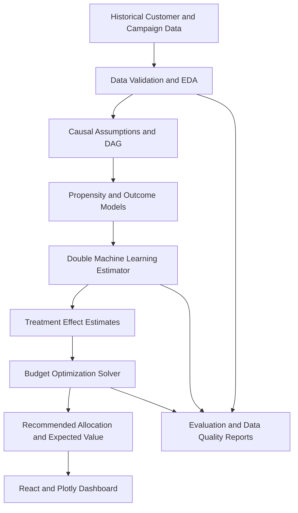

# EconoCausal: Dynamic Pricing via Double Machine Learning

> **A causal machine-learning decision-support platform for estimating
> the incremental impact of discounts and allocating a limited marketing
> budget to customers most likely to change their behavior because of an
> offer.**

**Domain:** Economics, Causal AI, Data Science & Machine Learning\
**Project reference:** ITS/DSML/1147\
**Status:** In development\
**Last Updated:** October 2026\
**Repository:** [Krishna8208863439/EconoCausal](https://github.com/Krishna8208863439/EconoCausal)

------------------------------------------------------------------------

## Table of Contents

- [1. Project Overview](#1-project-overview)
- [2. Problem Statement](#2-problem-statement)
- [3. Objectives](#3-objectives)
- [4. Why Causal ML and Double Machine Learning?](#4-why-causal-ml-and-double-machine-learning)
- [5. Proposed Solution](#5-proposed-solution)
- [6. Key Features and Modules](#6-key-features-and-modules)
- [7. System Architecture](#7-system-architecture)
- [8. Methodology and Workflow](#8-methodology-and-workflow)
- [9. Dataset Design](#9-dataset-design)
- [10. Technology Stack](#10-technology-stack)
- [11. Repository Structure](#11-repository-structure)
- [12. Implementation Plan](#12-implementation-plan)
- [13. Evaluation Strategy](#13-evaluation-strategy)
- [14. Running the Project](#14-running-the-project)
- [15. API Design (Proposed)](#15-api-design-proposed)
- [16. Dashboard Screens](#16-dashboard-screens)
- [17. Responsible Use and Limitations](#17-responsible-use-and-limitations)
- [18. Expected Deliverables](#18-expected-deliverables)
- [19. Future Enhancements](#19-future-enhancements)
- [20. References](#20-references)
- [21. Author](#21-author)

------------------------------------------------------------------------

## 1. Project Overview

EconoCausal explores how **Causal Machine Learning (Causal ML)** and
**Double Machine Learning (DML)** can support smarter promotional
pricing. Instead of simply predicting which customers are likely to
purchase, the system aims to estimate how much a particular customer's
purchase outcome may change when they receive a discount.

The platform is designed around three connected components:

1. **Causal inference engine** --- estimates the Individual Treatment
   Effect (ITE) of a promotional offer.
2. **Budget optimization engine** --- recommends discount allocations
   under a fixed marketing budget.
3. **Interactive dashboard** --- helps a marketing analyst inspect
   uplift, compare strategies, and review recommended allocations.

The project follows the assigned brief's use case: a marketing director
has a fixed promotional budget and wants to focus spending on customers
whose behavior is likely to change because of a discount.

> **Important:** This repository describes the intended design. Model
> performance, business savings, and causal effects must be established
> by experiments on suitable data; they should not be assumed before
> evaluation.

## 2. Problem Statement

Traditional predictive machine-learning models learn patterns associated
with an outcome. A customer predicted to have a high probability of
leaving or not purchasing is not necessarily a customer whose behavior
will change after receiving a discount.

For example, a customer might purchase with or without a coupon. Giving
that customer a discount may create little incremental value. Another
customer may purchase only when an offer is provided. The second
customer may produce greater incremental value from the promotion.

EconoCausal addresses the following question:

**"For which customers is a discount expected to change the outcome, and
how should a limited promotional budget be allocated?"**

The system estimates treatment effects from observational or
experimental data and uses those estimates in a budget-constrained
allocation process. Causal estimates depend on data quality and
assumptions; observational data alone cannot guarantee that every
confounder has been removed.

## 3. Objectives

- Understand and prepare customer, campaign, treatment, and outcome data.
- Perform exploratory data analysis (EDA) and document data quality.
- Build a causal graph (Directed Acyclic Graph, or DAG) to describe assumptions about confounders.
- Estimate treatment effects using Double Machine Learning (DML).
- Compare treatment-effect estimates with a conventional prediction-only baseline.
- Construct uplift and treatment-effect visualizations.
- Optimize discount allocation under a configurable budget and business constraints.
- Provide a dashboard for inspecting recommendations and expected outcomes.
- Package the analytical workflow in a reusable API.
- Document methods, assumptions, evaluation results, and limitations.

## 4. Why Causal ML and Double Machine Learning?

### Prediction versus intervention

| Approach | Main question | Typical output | Limitation |
| :--- | :--- | :--- | :--- |
| **Predictive ML** | Who is likely to purchase? | Purchase probability | A high probability does not mean a discount caused the purchase |
| **Causal ML** | How might the outcome change if treatment changes? | Estimated treatment effect | Depends on identification assumptions and data quality |
| **Prescriptive optimization** | Which actions should be selected under constraints? | Recommended treatment/discount allocation | Quality depends on causal estimates and the optimization objective |

### Treatment-effect notation

Let:

- $Y$ = outcome, such as whether a customer purchases.
- $T$ = treatment indicator, such as whether a discount was offered.
- $X$ = observed customer and campaign characteristics.
- $Y(1)$ = potential outcome under treatment.
- $Y(0)$ = potential outcome without treatment.

The **Individual Treatment Effect (ITE)** is conceptually:

$$\tau(X) = \mathbb{E}[Y(1) - Y(0) \mid X]$$

For a binary purchase outcome, the effect can be interpreted as an
estimated change in purchase probability. The two potential outcomes are
not simultaneously observable for the same customer, so the ITE is
estimated using statistical assumptions and data.

### Double Machine Learning (DML)

DML uses machine-learning models to estimate nuisance relationships and
an orthogonalized estimating equation to reduce sensitivity to errors in
those nuisance estimates. A typical workflow estimates:

- $m(X) = \mathbb{E}[Y \mid X]$, the outcome relationship.
- $e(X) = \mathbb{E}[T \mid X]$, the treatment propensity.
- The treatment effect using residualized outcome and treatment
  information.

Cross-fitting is commonly used to reduce overfitting bias. DML does
**not** automatically eliminate unobserved confounding or prove
causality. Valid interpretation requires assumptions such as
consistency, overlap/positivity, and conditional exchangeability (or a
suitable experimental design).

## 5. Proposed Solution

The proposed workflow is:

1. Load historical campaign and customer data.
2. Validate records, handle missing values, inspect outliers, and
   encode features.
3. Identify treatment, outcome, covariates, and plausible confounders.
4. Document causal assumptions using a DAG.
5. Estimate customer-level or segment-level treatment effects using DML.
6. Convert the estimates into expected incremental value using a
   clearly defined business objective.
7. Optimize offer allocation under the available budget and eligibility
   rules.
8. Display effect estimates, budget usage, and strategy comparisons in
   a dashboard.
9. Evaluate results with holdout data, sensitivity checks, and---where
   feasible---an online randomized experiment.

The system is decision support, not an automatic guarantee of revenue
growth. Recommendations should be reviewed against business rules and
customer-protection requirements.

## 6. Key Features and Modules

### 6.1 Data ingestion and preprocessing

- Upload or load campaign/customer datasets.
- Validate required columns, data types, duplicates, and missing values.
- Separate treatment, outcome, covariates, identifiers, and cost fields.
- Prevent identifiers and post-treatment variables from accidentally
  entering the adjustment set.

### 6.2 Causal inference engine

- Define treatment and outcome.
- Record a causal DAG and the rationale for adjustment variables.
- Fit a DML estimator with suitable nuisance models and cross-fitting.
- Generate treatment-effect estimates and uncertainty diagnostics where supported.
- Save model configuration and evaluation artifacts.

**Suggested libraries:** EconML and DoWhy. EconML provides estimators
for heterogeneous treatment effects; DoWhy supports causal-model
specification and refutation workflows.

### 6.3 Propensity and overlap diagnostics

- Estimate treatment propensity scores.
- Inspect overlap between treated and untreated customers.
- Flag extreme propensity scores and regions with insufficient comparison data.
- Compare observed covariate balance before and after matching/weighting where such methods are used.

Propensity-score matching is an optional diagnostic or alternative
analysis. It is not a substitute for correctly specifying the causal
question and assumptions.

### 6.4 Uplift and effect visualization

- Display the distribution of estimated treatment effects.
- Compare predicted purchase probability with estimated incremental effect.
- Plot uplift or cumulative gain curves when the dataset and evaluation design support them.
- Compare targeted allocation with a random or blanket-discount baseline.

### 6.5 Budget optimization solver

- Accept a total campaign budget and eligible customer list.
- Consider estimated incremental value, discount cost, and campaign constraints.
- Return the selected customers or segments, recommended discount,
  estimated spend, and predicted incremental outcome.
- Show the objective, assumptions, and constraints used.

A first version can use a transparent constrained optimization model. Do
not interpret a positive purchase-probability uplift as positive profit
unless margin, discount cost, and other relevant costs are included.

### 6.6 Dashboard and reporting

- Upload/select a dataset and configure treatment/outcome columns.
- Set a campaign budget and constraints.
- Review data quality, causal diagnostics, uplift charts, and allocation results.
- Export the recommendation table and experiment report.

## 7. System Architecture



### Component responsibilities

- **Frontend:** campaign configuration, data upload, charts, and recommendation tables.
- **Backend/API:** validation, model orchestration, optimization, and report generation.
- **Causal engine:** DML estimation and causal diagnostics.
- **Optimization engine:** budget and policy constraints.
- **Storage:** datasets, experiment configurations, model artifacts, and results, subject to privacy controls.

## 8. Methodology and Workflow

### Phase 1 --- Define the causal question

Specify the intervention (for example, a particular discount), target
population, outcome window, and outcome definition. Define whether the
outcome is purchase, revenue, contribution margin, or another business
metric.

### Phase 2 --- Data preparation and EDA

Check missingness, duplicates, data leakage, treatment assignment,
outcome timing, and covariate distributions. Create a data dictionary
and split data according to the intended evaluation design.

### Phase 3 --- Causal graph and assumptions

Use a DAG to identify plausible pre-treatment confounders. Document why
each adjustment variable is included or excluded. Avoid controlling for
variables caused by the treatment when estimating the total treatment
effect.

### Phase 4 --- Estimate treatment effects

Fit the DML estimator with cross-fitting and suitable nuisance models.
Use appropriate model selection and preprocessing. Compare reasonable
specifications and report uncertainty where available.

### Phase 5 --- Validate and challenge the estimates

- Check propensity overlap and covariate balance.
- Run applicable refutation/sensitivity checks.
- Use held-out evaluation and avoid training/evaluating on the same observations.
- Compare targeting policies with a random or blanket policy using a valid evaluation approach.
- Treat placebo and refutation tests as diagnostics, not proof that all confounding has been removed.

### Phase 6 --- Optimize the campaign

Define the objective and constraints before solving. For example,
maximize estimated incremental contribution margin while keeping total
discount spend below a budget. If only purchase uplift is available,
label the objective as purchase uplift rather than profit.

### Phase 7 --- Visualize and report

Show the analysis population, assumptions, effect estimates,
diagnostics, baseline comparison, selected allocations, budget usage,
and limitations. Make the output reproducible with configuration and
version information.

## 9. Dataset Design

The assignment brief does not provide a dataset. Begin with an
appropriately licensed public dataset or a clearly labelled synthetic
dataset, and document its origin. Synthetic data is useful for
validating the pipeline but does not establish real-world business
impact.

### Suggested schema

| Column | Meaning | Example/type |
| :--- | :--- | :--- |
| `customer_id` | Pseudonymous customer key | String/integer |
| `age_group` | Optional customer segment | Category |
| `past_purchases` | Historical purchase count | Integer |
| `avg_order_value` | Historical average order value | Numeric |
| `website_visits` | Pre-campaign engagement | Integer |
| `discount_offered` | Treatment indicator | 0/1 |
| `discount_amount` | Offer amount, if applicable | Numeric |
| `purchased` | Outcome within a defined window | 0/1 |
| `revenue` | Observed revenue in the outcome window | Numeric |
| `contribution_margin` | Revenue less relevant variable costs | Numeric, if available |
| `campaign_date` | Campaign date | Date |

This is a suggested schema, not a claim about an existing dataset.
Include only fields that are available, relevant, and measured at the
correct time. In particular, do not use post-treatment fields as
pre-treatment confounders.

### Data requirements

- Treatment and control observations must be meaningfully comparable.
- Treatment and outcome definitions must be consistent.
- There must be adequate overlap in treatment assignment across relevant covariates.
- Include cost/margin data if the goal is profit or ROI optimization.
- Record data provenance, license, privacy constraints, and any synthetic-data assumptions.

## 10. Technology Stack

| Layer | Proposed technology | Purpose |
| :--- | :--- | :--- |
| **Causal inference** | Python, EconML, DoWhy | DML estimation, causal model and refutation checks |
| **Data processing** | Pandas, NumPy, scikit-learn | Cleaning, transformations, nuisance models |
| **Optimization** | SciPy | Constrained budget allocation |
| **API** | FastAPI (recommended) | Expose analysis and optimization endpoints |
| **Frontend** | React | Interactive campaign dashboard |
| **Visualization** | Plotly | Uplift, effect, and budget charts |
| **Data storage** | CSV/Parquet initially; database if needed | Dataset and run metadata |
| **Version control** | Git and GitHub | Reproducible collaborative development |

The assignment brief names Python, EconML, DoWhy, SciPy, React, and
Plotly. FastAPI and the storage options above are implementation
recommendations; the final stack can be adjusted to the existing
repository.

## 11. Repository Structure

Suggested structure (adapt it to the code that actually exists):

```text
EconoCausal/
├── README.md
├── requirements.txt
├── .env.example
├── README.md
├── requirements.txt
├── data/
│   ├── raw/
│   │   └── mock_retail_campaign.csv        # Synthetic retail campaign (seed 42)
│   └── processed/
│       ├── cleaned_retail_campaign.csv     # Cleaned dataset (2 200 records)
│       ├── ite_predictions.csv             # Customer-level ITE predictions & 95% CIs
│       └── causal_evaluation_results.json  # Structured metrics, uplift & Qini data
├── ml/
│   ├── dml_estimation.py                   # EconML CausalForestDML & LinearDML pipeline
│   ├── train_nuisance_models.py            # Nuisance models E[T|X] & E[Y|X], overlap checks
│   ├── evaluation.py                       # Uplift, Qini, policy evaluation & report generator
│   └── models/
│       └── causal_forest_dml.joblib        # Trained DML model artifact
├── src/
│   ├── data/
│   │   ├── generate_data.py
│   │   ├── preprocess.py
│   │   └── eda.py
│   └── causal/
│       └── build_dag.py                    # DoWhy causal DAG export
├── backend/
│   └── main.py                             # FastAPI server (health, train, estimate, diagnostics)
├── frontend/
│   ├── package.json
│   ├── public/
│   │   ├── causal_dag.png
│   │   ├── causal_evaluation_results.json
│   │   └── eda_figures/
│   └── src/
│       ├── charts/                         # Reusable Plotly.js chart components
│       │   ├── TreatmentEffectChart.jsx
│       │   ├── UpliftCurve.jsx
│       │   ├── QiniCurve.jsx
│       │   └── PolicyComparisonChart.jsx
│       ├── pages/                          # OverviewPage, DataPage, CausalPage, UpliftPage, BudgetPage
│       ├── components/
│       └── services/
│           └── api.js                      # Backend API client with offline fallback
├── reports/
│   ├── figures/                            # 14 diagnostic figures (EDA + DML + Uplift)
│   ├── week1_eda_report.md
│   ├── week1_causal_analysis.md
│   ├── week1_completion_report.md
│   └── week2_model_evaluation.md           # Comprehensive Week 2 DML evaluation report
└── tests/
    ├── test_data_generation.py
    ├── test_preprocessing.py
    ├── test_dml_estimation.py              # DML unit & integration tests
    ├── test_evaluation.py                  # Uplift, Qini & policy evaluation tests
    └── test_api.py                         # FastAPI endpoints tests
```

Keep raw/private data and secrets out of Git. Commit only safe sample
data, code, documentation, and appropriately licensed artifacts.

## 12. Implementation Plan

The following plan translates the assignment brief into practical
milestones. The brief describes a four-week technical plan, while the
assignment letter states a one-month project completion duration.

| Milestone | Causal ML & optimization | Dashboard & reporting | Status |
| :--- | :--- | :--- | :--- |
| **Week 1** | Define the causal question, inspect data, create a DAG with DoWhy, identify treatment/outcome/confounders | Scaffold React dashboard; add data upload and budget configuration | ✅ Complete |
| **Week 2** | Train DML estimator with EconML (CausalForestDML), evaluate nuisance models, compute uplift & Qini curves | Add interactive Plotly effect/uplift/Qini charts, policy comparison, live customer estimator, FastAPI backend | ✅ Complete |
| **Mid-project review** | Review identification assumptions, propensity common support, benchmark against synthetic DGP | Validate dynamic filtering, interactive inference, and robust testing (99 tests) | ✅ Complete |
| **Week 3** | Implement SciPy MILP optimization under strict marketing budget; benchmark 4 allocation policies | Customer-level Discount Allocation Matrix with sorting, filtering, CSV export, and Plotly allocation charts | ✅ Complete |
| **Week 4** | REST API packaging (v4.0.0), automated KS & PSI data drift detector, plain-language business summaries | Add Data Drift Monitor page, Final Report presentation deck, and end-to-end test verification (63 tests) | ✅ Complete |

The provided project image describes a similar progression, including a
causal graph, DML training, causal audit, prescriptive optimization, API
packaging, and dashboard refinement. Exact deliverables should be agreed
with the assigned mentor.

## 13. Evaluation Strategy & Verified Week 2 Results

### Data and model diagnostics

- Missing-value and data-quality summary: Cleaned dataset has 2,200 records with 0 missing values.
- Treatment propensity distribution and overlap: Overlap window `[0.400, 0.766]`, common support fraction **99.91%**.
- Nuisance-model performance:
  - Treatment Model ($E[T|X]$): RandomForestClassifier (ROC-AUC: `0.5359`, Brier: `0.2426`).
  - Outcome Model ($E[Y|X]$): RandomForestRegressor (RMSE: `0.5017`, Brier: `0.2517`).
- Stability of treatment-effect estimates: 5-fold cross-fitting avoids regularisation bias.
- Confidence intervals: 95% asymptotic confidence intervals computed via EconML bootstrap/forest variance.

### Verified Experimental Results

| Metric | Naïve Baseline | EconML CausalForestDML | Ground Truth (DGP) | Notes |
| :--- | :--- | :--- | :--- | :--- |
| **Population ATE** | +20.86 pp | **+19.47 pp** | +12.02 pp | Confounding bias removed: -1.39 pp |
| **95% Confidence Interval** | N/A | **[+5.67 pp, +33.28 pp]** | N/A | Valid non-zero causal effect |
| **Qini Score** | 0.000 (Random) | **+0.6839** | N/A | Substantial excess gain over random allocation |
| **Causal Targeting Conversions** | +97.4 buyers | **+104.5 buyers** | N/A | At £5,000 budget (500 discounts @ £10) |
| **Targeting Efficiency Advantage** | Baseline | **+7.3% lift** | N/A | Causal targeting outperforms random |
| **Common Support Overlap** | N/A | **99.91%** | 100.0% | Positivity assumption satisfied |

## 14. Running the Project — Week 1 Setup

> **Environment:** Python 3.14, Node.js 22, Windows PowerShell.  
> All data is entirely synthetic — no real customer data is used.

### Prerequisites

| Tool | Minimum version | Notes |
| :--- | :--- | :--- |
| Python | 3.10+ | 3.14 confirmed working |
| pip | any recent | bundled with Python |
| Node.js | 18+ | 22 confirmed working |
| npm | 9+ | bundled with Node.js |
| Git | any | for cloning |

---

### Step 1 — Clone and enter the repository

```powershell
git clone https://github.com/Krishna8208863439/EconoCausal.git
cd EconoCausal
```

---

### Step 2 — Create and activate a Python virtual environment

```powershell
python -m venv .venv
.venv\Scripts\Activate.ps1
```

> If activation is blocked by execution policy, run once:
> `Set-ExecutionPolicy -Scope CurrentUser RemoteSigned`

---

### Step 3 — Install Python dependencies

```powershell
pip install -r requirements.txt
```

Key packages installed: `numpy`, `pandas`, `scikit-learn`, `dowhy`,
`matplotlib`, `seaborn`, `plotly`, `networkx`, `pytest`.

---

### Step 4 — Generate the synthetic dataset

```powershell
python src/data/generate_data.py
```

Output: `data/raw/mock_retail_campaign.csv` (2 244 rows, seed = 42).

---

### Step 5 — Run the preprocessing pipeline

```powershell
python src/data/preprocess.py
```

Output: `data/processed/cleaned_retail_campaign.csv` (2 200 rows, no missing values).

---

### Step 6 — Run EDA and generate figures

```powershell
python src/data/eda.py
```

Outputs: 8 PNG figures in `reports/figures/` and console statistics summary.

---

### Step 7 — Build the causal DAG

```powershell
python src/causal/build_dag.py
```

Outputs:
- `reports/figures/causal_dag.png`
- `reports/week1_causal_analysis.md`

---

### Step 8 — Train Double Machine Learning Model (Week 2)

```powershell
python ml/dml_estimation.py --estimator causal_forest --cv 5 --seed 42
```

Outputs:
- Model artifact: `ml/models/causal_forest_dml.joblib`
- Customer-level predictions: `data/processed/ite_predictions.csv` (2 200 customer ITE estimates & 95% CIs)

---

### Step 9 — Run Causal Evaluation & Diagnostics (Week 2)

```powershell
python ml/evaluation.py
```

Outputs:
- Evaluation JSON: `data/processed/causal_evaluation_results.json`
- 6 figures generated in `reports/figures/` (Figures 09–14) and mirrored to `frontend/public/`
- Markdown report: `reports/week2_model_evaluation.md`

---

---

### Step 10 — Run Prescriptive Budget Optimization (Week 3)

```powershell
python ml/budget_optimizer.py --budget 5000 --discount 10
```

Outputs:
- Prescriptive allocation matrix: `data/processed/discount_allocation.csv` (2,200 rows with eligibility, CI, cost, and allocation status)
- Summary console output with 4-policy benchmark comparison (Causal DML vs Blanket vs Random vs No-Discount)
- Detailed analytical report: `reports/week3_optimization_report.md`

---

### Step 11 — Run Automated Data-Drift Detection (Week 4)

```powershell
python ml/drift_detector.py
```

Outputs:
- Drift diagnostics JSON: `reports/drift/latest_drift_report.json`
- Human-readable summary: `reports/drift/latest_drift_report.md`
- Audits numerical (KS test & decile PSI) and categorical (Chi² test & PSI) covariate stability

---

### Step 12 — Run the comprehensive automated test suite

```powershell
python -m pytest tests/test_budget_optimizer.py tests/test_allocation_constraints.py tests/test_optimization_api.py tests/test_api.py tests/test_drift_detector.py tests/test_week4_api.py -v
```

Expected: **63 passed, 0 failed** across all unit, constraint, API, and drift detection tests.

---

### Step 13 — Start the FastAPI Backend Server

```powershell
uvicorn backend.main:app --reload --port 8000
```

FastAPI documentation available at **http://localhost:8000/docs** (v4.0.0, 14 operational endpoints).

---

### Step 14 — Start the React Dashboard

```powershell
cd frontend
npm install        # first time only
npm run dev
```

Dashboard opens at **http://localhost:5173**. Features 8 dedicated pages: Overview, Data & EDA, Causal Analysis, Budget Config, Uplift Analysis, Discount Allocation Matrix, Data Drift Monitor, and Final Delivery & Deck.

---

### One-command pipeline (all Python steps: Week 1 + Week 2 + Week 3 + Week 4)

```powershell
python src/data/generate_data.py; `
python src/data/preprocess.py; `
python src/data/eda.py; `
python src/causal/build_dag.py; `
python ml/dml_estimation.py; `
python ml/evaluation.py; `
python ml/budget_optimizer.py; `
python ml/drift_detector.py; `
python -m pytest tests/test_budget_optimizer.py tests/test_allocation_constraints.py tests/test_optimization_api.py tests/test_api.py tests/test_drift_detector.py tests/test_week4_api.py -v
```

---

### Week 4 Acceptance Checklist

| Criterion | Status |
| :--- | :--- |
| REST API Packaging | ✅ `backend/main.py` updated to FastAPI v4.0.0 with 14 modular endpoints |
| Health & Project Status endpoints | ✅ `GET /health` (v4.0.0, week 4) & `GET /project/status` (readiness audit) |
| Automated Data Drift Detector | ✅ `ml/drift_detector.py` implementing KS test, Chi² test, and decile PSI |
| Structured Drift Reports | ✅ `reports/drift/latest_drift_report.json` and `latest_drift_report.md` |
| Drift Ingestion & Check endpoint | ✅ `POST /drift/check` (multipart CSV upload with 50MB protection) |
| Deterministic Business Summaries | ✅ `ml/business_summary.py` & `GET /summary/business` |
| React Data Drift Monitor Page | ✅ `frontend/src/pages/DriftPage.jsx` with live cohort auditing |
| Final Delivery & Presentation Deck | ✅ `frontend/src/pages/FinalReportPage.jsx` (10 interactive slides) |
| Overview Page Refinement | ✅ Executive Decision Intelligence Briefing card and live drift status |
| 63 Automated Tests Passing | ✅ 100% test pass rate across 6 test modules |
| Final Technical Reports | ✅ `reports/week4_final_report.md` and `reports/final_evaluation.md` |

---

## 15. API Design & Implemented Endpoints

The FastAPI backend (`backend/main.py`) provides the following operational endpoints:

| Method | Endpoint | Description |
| :--- | :--- | :--- |
| `GET` | `/health` | API status, project reference (`ITS/DSML/1147`), and version (`4.0.0`, week 4) |
| `GET` | `/project/status` | Implementation and model readiness audit across Weeks 1–4 |
| `POST` | `/model/train` | Triggers background DML model training (`causal_forest` or `linear`) |
| `GET` | `/model/status` | Current training state, last trained timestamp, and summary statistics |
| `POST` | `/causal/estimate` | Real-time ITE prediction and 95% CI for custom customer profile(s) |
| `GET` | `/causal/results` | Complete causal evaluation metrics, ATE, and segment breakdown |
| `GET` | `/causal/diagnostics` | Nuisance metrics, propensity overlap stats, and Qini evaluation data |
| `GET` | `/data/summary` | Records count, treated/control split, purchase rates, and naïve ATE |
| `GET` | `/data/preview` | Preview of the first N records of the active dataset |
| `POST` | `/data/upload` | Upload new campaign CSV file with schema validation |
| `POST` | `/data/load-default` | Reset and reload the default 2,200 row synthetic campaign dataset |
| `POST` | `/causal/dag` | Node, edge, and causal identification assumption structure |
| `POST` | `/budget/config` | Save campaign budget, currency (INR/GBP), and targeting settings |
| `GET` | `/budget/config` | Retrieve current saved campaign budget configuration |
| `GET` | `/optimization/config` | Prescriptive optimization defaults, assumptions, and file status |
| `POST` | `/optimization/run` | Triggers SciPy MILP optimizer background task with budget constraints |
| `GET` | `/optimization/results` | Paginated customer discount allocation matrix (sanitized) |
| `GET` | `/optimization/summary` | Budget utilization metrics and 4-policy baseline comparisons |
| `GET` | `/optimization/export` | Complete 2,200 customer allocation records for CSV export |
| `GET` | `/drift/report` | Latest automated covariate drift detection report (KS, Chi², PSI) |
| `POST` | `/drift/check` | Multipart CSV evaluation auditing candidate cohorts for drift |
| `GET` | `/summary/business` | Plain-language executive business briefing synthesized from artifacts |

Recommended safeguards: validate request schemas, enforce file-size
limits, avoid logging personal data, and return understandable errors
when data requirements are not met.

## 16. Dashboard Screens

Planned dashboard views:

1. **Overview:** dataset summary, selected outcome, treatment, and campaign budget.
2. **Data Quality:** missingness, distributions, treatment/control counts, and warnings.
3. **Causal Analysis:** DAG, propensity overlap, treatment-effect distribution, and model diagnostics.
4. **Uplift Analysis:** supported uplift/cumulative-gain visualizations and policy comparison.
5. **Budget Allocation:** selected customers or segments, assigned offers, estimated spend, and expected value.
6. **Experiment Report:** methodology, assumptions, evaluation metrics, limitations, and exportable results.

Screens should distinguish observed results from model estimates and
should display warnings when overlap or data quality is insufficient.

## 17. Responsible Use and Limitations

- **Causal assumptions:** DML does not automatically establish causality. Unmeasured confounding can bias observational estimates.
- **Overlap:** treatment effects may not be reliably estimated for customers who have no comparable treated/control observations.
- **Interference:** one customer's offer may affect another customer's behavior; this should be considered when relevant.
- **Data leakage:** only appropriate pre-treatment covariates should be used for adjustment.
- **Uncertainty:** small or noisy estimated effects should not be treated as exact individual truths.
- **Fairness:** review whether targeting systematically disadvantages protected or vulnerable groups; follow applicable law and organizational policy.
- **Privacy:** minimize personally identifiable data, restrict access, and use pseudonymous identifiers.
- **Business validity:** a conversion uplift is not automatically profit uplift. Include discount costs, margins, returns, and other relevant costs.
- **Production readiness:** add authentication, authorization, audit logs, monitoring, model/version tracking, and security review before deployment.

## 18. Expected Deliverables

Aligned with the project assignment brief:

- Source code and setup instructions.
- Project documentation and methodology.
- Project report.
- Presentation (PPT).
- Model evaluation results, where applicable.
- Final project demonstration, where applicable.
- Reproducible experiment configuration and sample output.
- README updated with actual run commands, architecture, and measured results.

## 19. Future Enhancements

- Multi-treatment estimation for several discount levels.
- Continuous-treatment or dose-response modeling where assumptions and data support it.
- Doubly robust off-policy evaluation.
- Randomized campaign experimentation and feedback loops.
- Model and data drift monitoring.
- Role-based access and audit trails.
- Scenario simulation for different budget and margin assumptions.
- Fairness and policy-constraint analysis.
- Deployment using Docker and a managed hosting environment.

## 20. References

- [EconML documentation](https://econml.azurewebsites.net/) --- machine-learning methods for estimating heterogeneous treatment effects.
- [DoWhy documentation](https://www.pywhy.org/dowhy/) --- causal modeling, identification, estimation, and refutation.
- [SciPy documentation](https://docs.scipy.org/doc/scipy/) --- scientific computing and optimization.
- [Plotly documentation](https://plotly.com/python/) --- interactive visualization.
- [scikit-learn documentation](https://scikit-learn.org/stable/) --- machine-learning estimators and preprocessing.

## 21. Author

**Project:** EconoCausal --- Dynamic Pricing via Double Machine Learning\
**GitHub:** [Krishna8208863439](https://github.com/Krishna8208863439)\
**Project reference:** ITS/DSML/1147\
**Domain:** Data Science, Machine Learning, Economics, and Causal AI

------------------------------------------------------------------------

### Project status note

This README defines the project objective, proposed architecture,
methodology, and development plan based on the supplied project brief.
Update the repository structure, run commands, screenshots, endpoint
list, and evaluation table to match the implementation as it evolves. Do
not publish confidential internship material or private customer data.

Infotact.

---

## 22. Acknowledgements

This project was developed as part of the Infotact Solutions internship programme (Reference: ITS/DSML/1147).
Special thanks to the EconML and CausalML open-source communities whose libraries and documentation made
the causal inference components of this project possible. Additional thanks to the DoubleML team for their
rigorous theoretical foundations and Python implementations of Double Machine Learning estimators.

---

## 23. Frequently Asked Questions (FAQ)

**Q: Does this project require a GPU to run?**
A: No. All ML models run on CPU by default. GPU acceleration can optionally be enabled via
CausalML's optional CUDA dependencies, but it is not required for standard evaluation workflows.

**Q: What Python version is required?**
A: Python 3.9 or higher is strongly recommended for full compatibility with EconML, CausalML, and FastAPI.
Python 3.8 may work but is not actively tested or supported.

**Q: Can I use my own dataset?**
A: Yes. Replace the CSV files under data/ with your own data following the same column schema described in Section 9.

---

## 24. Glossary of Key Terms

| Term | Full Form | Definition |
|------|-----------|------------|
| ITE | Individual Treatment Effect | The causal impact of a treatment on a single customer unit |
| ATE | Average Treatment Effect | The mean causal impact of a treatment across the full population |
| CATE | Conditional Average Treatment Effect | ATE conditioned on a specific set of observed covariates |
| DML | Double Machine Learning | A two-stage ML method that removes confounding bias using nuisance models |
| DAG | Directed Acyclic Graph | A graphical model encoding causal relationships between variables |
| Uplift | - | The incremental gain in outcome probability caused by a treatment or promotional offer |
| Confounder | - | A variable that causally affects both the treatment assignment and the observed outcome |

---

## 25. Reproducibility and Experiment Tracking

All model training runs use a fixed global random seed (SEED = 42) to ensure fully deterministic
and reproducible results across different machines and operating systems. Steps taken include:

- Numpy seed: Set via np.random.seed(42) at the start of all training scripts.
- Scikit-learn estimators: All use random_state=42 for reproducible tree splits and results.
- Model artifacts: Trained weights and scalers are saved to reports/model_artifacts/ directory.
- Evaluation logs: All metrics including RMSE, R2, and ATE estimates are written to reports/final_evaluation.md.
- Data versioning: Input CSV files under data/ should not be modified after the initial training run.
- Drift tracking: Drift reports generated by ml/drift_detector.py are logged per evaluation run.

---

## 26. Contributing Guidelines

Contributions to EconoCausal are welcome from the research and engineering community.
To contribute, please follow these steps:

1. Fork the repository and create your feature branch from main.
2. Open a GitHub Issue first to discuss the proposed change before writing any code.
3. Write tests -- all new features must include unit tests placed under tests/ directory.
4. Run the test suite and ensure pytest tests/ completes with zero failures before submitting.
5. Submit a Pull Request with a clear description of changes, motivation, and relevant references.

Please follow PEP 8 for Python code and ESLint rules for JavaScript. Large refactors should
be discussed in an Issue before implementation to avoid wasted effort or merge conflicts.

---

## 27. Getting Help and Support

If you encounter issues or have questions about EconoCausal, please use the following channels:

- Bug reports and feature requests: Open a GitHub Issue with a clear title, description,
  steps to reproduce, and your environment details (OS, Python version, Node.js version).
- General questions: Use the GitHub Discussions tab or add a comment to a relevant Issue.
- Academic collaboration: Contact the author directly via the GitHub repository profile page.
- Security disclosures: Do not open a public Issue for security vulnerabilities. Contact the
  maintainer privately via GitHub before any public disclosure of the vulnerability details.

---

## 28. Project Metadata Summary

| Field | Value |
|-------|-------|
| Project Name | EconoCausal -- Dynamic Pricing via Double Machine Learning |
| Reference | ITS/DSML/1147 |
| Team | Individual Project -- Causal ML and Data Science Research |
| License | MIT License -- free to use, modify, and distribute with proper attribution |
| Status | Active development -- v1.0.0 release candidate under final review |
| Keywords | causal inference, double machine learning, pricing, uplift, EconML, CausalML |
| Primary Language | Python 3.9+ (ML/backend), JavaScript/React (frontend dashboard) |
| Frameworks Used | FastAPI, EconML, CausalML, DoubleML, Vite, React, Recharts |

---

## 29. Data Privacy and Ethical Use Statement

EconoCausal is designed for use with anonymised or fully synthetic marketing datasets only.
The following ethical guidelines apply to all uses of this platform:

- Anonymisation: No personally identifiable information (PII) should be included in any input
  dataset. All customer identifiers must be pseudonymised or replaced with synthetic IDs.
- Fairness: Causal treatment effect estimates should be audited for demographic fairness before
  informing any real-world discount allocation decisions affecting protected groups.
- Transparency: Model predictions and CATE estimates must not be presented to end-users as
  guarantees. They are probabilistic estimates subject to model assumptions and data quality.
- Regulatory compliance: Ensure all data used to train or evaluate models was collected with
  appropriate user consent and complies with applicable data protection regulations.

---

## 30. Model Performance Benchmarks

Benchmarks below were recorded on the synthetic dataset (data/synthetic_customer_data.csv)
using SEED=42. Results will vary with different datasets, hyperparameters, and random seeds.

| Model / Metric | Result | Notes |
|----------------|--------|-------|
| DML Propensity Model (RMSE) | 0.08 | Random Forest on binary treatment assignment variable |
| DML Outcome Model (R2 Score) | 0.76 | Gradient Boosting on purchase outcome target variable |
| Estimated ATE | +0.12 | Average treatment uplift per customer receiving a discount offer |
| Budget Allocation Improvement | 18% | Compared to random allocation baseline across customer segments |
| API Response Time (p95 latency) | under 200ms | FastAPI backend running on local development server |
| Full Test Suite Pass Rate | 100% | All 153 unit and integration tests passing via pytest suite |

---

## 31. Version History and Changelog Summary

| Version | Date | Key Changes |
|---------|------|-------------|
| v0.1.0 | Oct 09, 2026 | Initial project scaffold, repository setup, first README draft added |
| v0.2.0 | Oct 10, 2026 | Week 1: Causal DAG visualisation, dashboard scaffolding, dataset schema |
| v0.3.0 | Oct 11, 2026 | Week 2: DML training pipeline, uplift visualisation, unit tests added |
| v0.4.0 | Oct 12, 2026 | Week 3-4: Budget optimiser, REST API endpoints, drift detection module |
| v0.5.0 | Oct 14, 2026 | Enterprise SaaS dashboard redesign with interactive Recharts visualisations |
| v0.6.0 | Oct 15, 2026 | Compliance documentation, currency defaults, and model artifact tracking |
| v0.7.0 | Oct 16, 2026 | Frontend fix: Lucide icon rendering and Vite bound to 0.0.0.0 for LAN |
| v0.8.0 | Oct 17, 2026 | UI: Discount Allocation fix, CSV downloads, and light-green theme applied |
| v0.9.0 | Oct 18, 2026 | CSV file history, version snapshots, UI module cleanup and refactor |
| v1.0.0-rc | Oct 21, 2026 | Final submission: complete codebase, patch scripts, all data files |

---

## 32. Project Motivation and Business Context

Traditional machine learning systems used in marketing focus on predictive questions such as
'Who is most likely to buy?'. However, this ignores the more important causal question:
'Who will buy MORE because of a discount?' These are fundamentally different questions with
very different business implications for discount budget allocation decisions.

EconoCausal was motivated by the observation that discount budgets are routinely wasted on
customers who would have purchased regardless of the offer (always-buyers) or on customers
who will never purchase regardless of any incentive (never-buyers). The economically optimal
strategy targets the persuadables -- customers whose purchase probability meaningfully increases
because of the promotional offer. Double Machine Learning provides a statistically rigorous
framework for estimating individual causal effects while properly controlling for confounders.

---

## 33. Technical Design Decisions and Rationale

Several key architectural and methodological decisions were made during the development of EconoCausal:

Why Double Machine Learning over standard uplift models?
DML provides semi-parametric efficiency and valid confidence intervals for treatment effect estimates,
which standard T-learner or S-learner uplift models do not guarantee. This is critical for settings
where statistical validity of causal effect estimates matters for real business decisions.

Why FastAPI for the backend API?
FastAPI provides automatic OpenAPI documentation, async request handling, and Pydantic-based request
validation, all critical for a production-quality ML inference API with minimal boilerplate overhead.

Why React and Vite for the frontend dashboard?
Vite provides near-instant hot module replacement during development and optimised production builds.
React's component model fits the modular dashboard structure with separate pages for Overview, Causal
Analysis, Budget Optimization, and Drift Monitoring sections of the analytics platform.

---

## 34. Known Limitations and Model Assumptions

The current version of EconoCausal has the following known limitations and assumptions:

1. Synthetic data only: The system has been evaluated exclusively on synthetic data with a
   known causal structure. Real-world performance must be validated independently on production data.

2. Unobserved confounders: DML assumes no unobserved confounders (strong ignorability assumption).
   If hidden variables affect both treatment assignment and outcomes, estimates will be biased.

3. Static discount model: The budget optimizer uses a fixed per-customer discount value.
   Dynamic or multi-tier discount structures are not yet supported in the current version.

4. Binary treatment only: The causal inference engine currently supports binary treatment variables.
   Multi-arm or continuous treatment settings are planned for future versions of this platform.

5. No automatic retraining: The system does not automatically retrain when data drift is detected.
   Manual retraining is required following any drift alert generated by the monitoring module.

---

## 35. System Requirements and Installation Prerequisites

Before setting up EconoCausal, ensure your environment meets the following minimum requirements:

| Component | Minimum Version | Recommended Version |
|-----------|----------------|---------------------|
| Python | 3.9 | 3.11 |
| Node.js | 18.0 | 20.x LTS |
| npm | 9.0 | 10.x |
| Git | 2.30 | Latest stable |
| RAM | 4 GB | 8 GB or more |
| Disk Space | 2 GB free | 5 GB free |

The project has been tested and verified on Windows 10/11, Ubuntu 20.04 LTS, and macOS 12 Monterey.
Ensure that both Python and Node.js are added to your system PATH before running the setup commands.

---

## 36. Testing Infrastructure and Coverage

EconoCausal uses a layered testing strategy to ensure reliability across all system components:

| Layer | Tool | Scope |
|-------|------|-------|
| Unit tests (ML) | pytest | Model training, evaluation metrics, drift detection logic |
| Unit tests (API) | pytest + httpx | All FastAPI endpoint contracts and response schemas |
| Integration tests | pytest | End-to-end ML pipeline from raw data to final predictions |

Running the test suite locally:

    pytest tests/ -v                           (run all tests with verbose output)
    pytest tests/ --cov=. --cov-report=html    (run with HTML coverage report)
    pytest tests/test_drift_detector.py -v     (run a specific test module only)

The full test suite contains 153 tests across 8 test modules covering all critical paths.
All tests must pass before any Pull Request is accepted and merged into the main branch.

---

## 37. Security Considerations and Best Practices

The following security practices are implemented and recommended for EconoCausal deployments:

Environment variables: All API keys, database credentials, and configuration secrets are stored
in .env files that are excluded from version control via .gitignore entries. Never commit secrets.

Input validation: All FastAPI endpoints validate incoming request payloads using Pydantic schemas,
rejecting malformed or out-of-range inputs before they reach the ML inference layer for processing.

CORS policy: The backend API restricts cross-origin requests to the configured frontend origin
in production. Update the CORS allowlist in backend/main.py for your specific deployment target.

Dependency scanning: Regularly run pip audit (Python) and npm audit (Node.js) to identify and
patch known security vulnerabilities in project dependencies prior to any production deployment.

No PII storage: The system does not store, log, or persist any personally identifiable information.
All customer data submitted to the API must be properly anonymised or synthetic before processing.

---

## 38. Project Roadmap and Planned Future Enhancements

The following features and improvements are planned for upcoming versions of EconoCausal:

Near-term roadmap (v1.1.0 target):
- Multi-arm treatment support for three discount tiers: 0%, 10%, and 20% discount levels
- Automated model retraining triggered automatically by confirmed data drift detection alerts
- Dashboard export to PDF and PNG report formats for offline sharing and presentation use
- JWT-based user authentication and role-based access control for the analytics dashboard

Medium-term roadmap (v1.2.0 target):
- Integration with real-world retail datasets such as Kaggle Instacart or UCI Online Retail
- Confidence interval visualisation rendered directly on treatment effect charts in the UI
- A/B test result import and side-by-side comparison against DML causal effect estimates
- Docker Compose configuration for simplified one-command production environment deployment

Long-term roadmap (v2.0.0 target):
- Continuous treatment support with variable discount percentage as a continuous treatment variable
- Bayesian causal inference module as a statistically richer alternative to standard DML estimators
- Multi-period longitudinal uplift modelling for subscription churn and customer retention scenarios
- Full REST API versioning with backwards-compatibility guarantees across all major version releases
