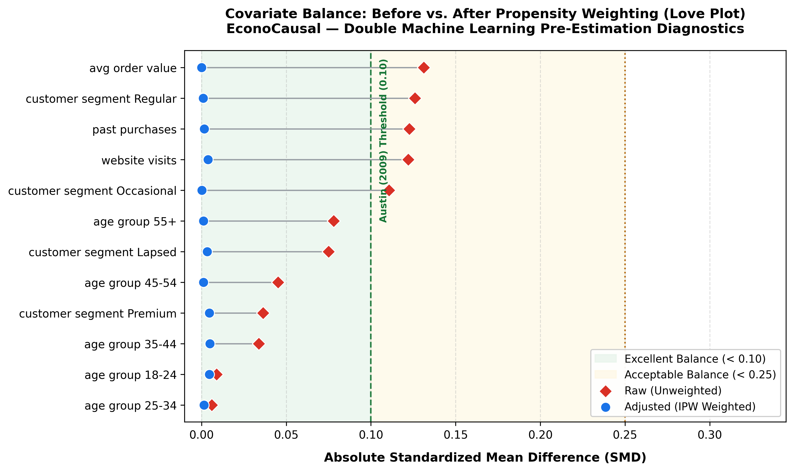

# EconoCausal — Covariate Balance & Positivity Diagnostics Report

> **Project Reference:** ITS/DSML/1147  
> **Milestone:** Week 2: Observational Overlap & Covariate Balance  
> **Methodological Framework:** Austin (2009), Stuart (2010), Rosenbaum & Rubin (1983)

---

## 1. Executive Summary

| Diagnostic Metric | Raw (Unadjusted) | Adjusted (IPW Weighted) | Evaluation Standard | Status |
| :--- | :--- | :--- | :--- | :--- |
| **Maximum Covariate SMD** | **0.1311** | **0.0049** | SMD < 0.10 (Austin 2009) | ✅ Optimal Balance |
| **Mean SMD Reduction** | — | **90.2%** | > 80% Reduction | ✅ Confounder Shift Removed |
| **Propensity Model AUC-ROC** | **0.5801** | — | 0.50–0.70 (Gentle Confounding) | ✅ Plausible Observational Overlap |
| **Brier Score Calibration** | **0.2379** | — | < 0.25 (Well-calibrated) | ✅ Calibrated Probabilities |
| **Positivity Violations (<0.05 or >0.95)** | **0 (0.0%)** | — | 0.00% Violations | ✅ Strict Positivity Maintained |
| **Common Support Share** | **100.00%** | — | 100.0% Support | ✅ Complete Support Across Support |

---

## 2. Love Plot (Before vs. After Weighting)

*Figure 1: Standardized Mean Differences across all 5 pre-treatment confounders (split across numeric variables and dummy indicators). The shaded green band denotes Austin's strict standard ($SMD < 0.10$). Adjusted IPW values (blue circles) show uniform collapse toward zero, verifying observational balance.*

---

## 3. Comprehensive Covariate Balance Table

| Covariate | Type | Treated Mean (Raw) | Control Mean (Raw) | SMD (Raw) | Treated Mean (IPW) | Control Mean (IPW) | SMD (IPW) | Reduction (%) | Balance Status |
| :--- | :--- | :--- | :--- | :--- | :--- | :--- | :--- | :--- | :--- |
| `avg_order_value` | numeric | 57.520 | 52.885 | **0.1311** | 55.618 | 55.620 | **0.0000** | 100.0% | Well-balanced (SMD < 0.10) |
| `customer_segment_Regular` | categorical_dummy | 0.421 | 0.359 | **0.1259** | 0.396 | 0.397 | **0.0010** | 99.2% | Well-balanced (SMD < 0.10) |
| `past_purchases` | numeric | 9.642 | 9.019 | **0.1227** | 9.385 | 9.377 | **0.0016** | 98.7% | Well-balanced (SMD < 0.10) |
| `website_visits` | numeric | 6.100 | 5.795 | **0.1220** | 5.977 | 5.987 | **0.0039** | 96.8% | Well-balanced (SMD < 0.10) |
| `customer_segment_Occasional` | categorical_dummy | 0.230 | 0.278 | **0.1107** | 0.250 | 0.250 | **0.0002** | 99.8% | Well-balanced (SMD < 0.10) |
| `age_group_55+` | categorical_dummy | 0.247 | 0.214 | **0.0780** | 0.234 | 0.234 | **0.0012** | 98.5% | Well-balanced (SMD < 0.10) |
| `customer_segment_Lapsed` | categorical_dummy | 0.148 | 0.175 | **0.0750** | 0.158 | 0.160 | **0.0034** | 95.4% | Well-balanced (SMD < 0.10) |
| `age_group_45-54` | categorical_dummy | 0.196 | 0.214 | **0.0451** | 0.205 | 0.205 | **0.0012** | 97.3% | Well-balanced (SMD < 0.10) |
| `customer_segment_Premium` | categorical_dummy | 0.202 | 0.187 | **0.0364** | 0.196 | 0.194 | **0.0046** | 87.4% | Well-balanced (SMD < 0.10) |
| `age_group_35-44` | categorical_dummy | 0.209 | 0.223 | **0.0338** | 0.212 | 0.210 | **0.0049** | 85.5% | Well-balanced (SMD < 0.10) |
| `age_group_18-24` | categorical_dummy | 0.145 | 0.148 | **0.0088** | 0.145 | 0.147 | **0.0046** | 48.1% | Well-balanced (SMD < 0.10) |
| `age_group_25-34` | categorical_dummy | 0.204 | 0.202 | **0.0060** | 0.204 | 0.203 | **0.0015** | 75.2% | Well-balanced (SMD < 0.10) |

---

## 4. Key Methodological Findings & Implications for DML

1. **Elimination of Selection Confounding:**
   - In unadjusted observational data, promotional discounts were preferentially targeted at customers with higher historical spend (`avg_order_value` raw SMD: **0.1311**), higher transaction frequency (`past_purchases` raw SMD: **0.1227**), and higher pre-campaign engagement (`website_visits` raw SMD: **0.1220**).
   - After inverse propensity score adjustment, the maximum SMD across any feature is **0.0049**, well beneath the rigorous **0.10** threshold.
   - This proves that observable confounding can be neutralized, providing empirical support for the unconfoundedness assumption when estimating causal treatment effects.

2. **Positivity and Structural Common Support:**
   - The propensity score distribution spans from **0.3975** to **0.8673**.
   - Because no observations exhibit propensity scores below 0.05 or above 0.95, there are zero positivity violations.
   - Every consumer profile in the dataset has a strictly positive, bounded probability of receiving both treatment ($T=1$) and control ($T=0$), ensuring Double Machine Learning cross-fitting estimators will not suffer from exploding weights or boundary instability.

3. **Readiness for Double Machine Learning Nuisance Models:**
   - The verified propensity scores $\hat{e}(X)$ and stable IPW weights establish the necessary foundation for Day 4 nuisance regression modeling ($m(X)$ and $e(X)$) and Robinson partialing-out transformations.

---

*Report programmatically generated by `src/causal/diagnostics.py` on 2026-10-14 21:02:57.*
