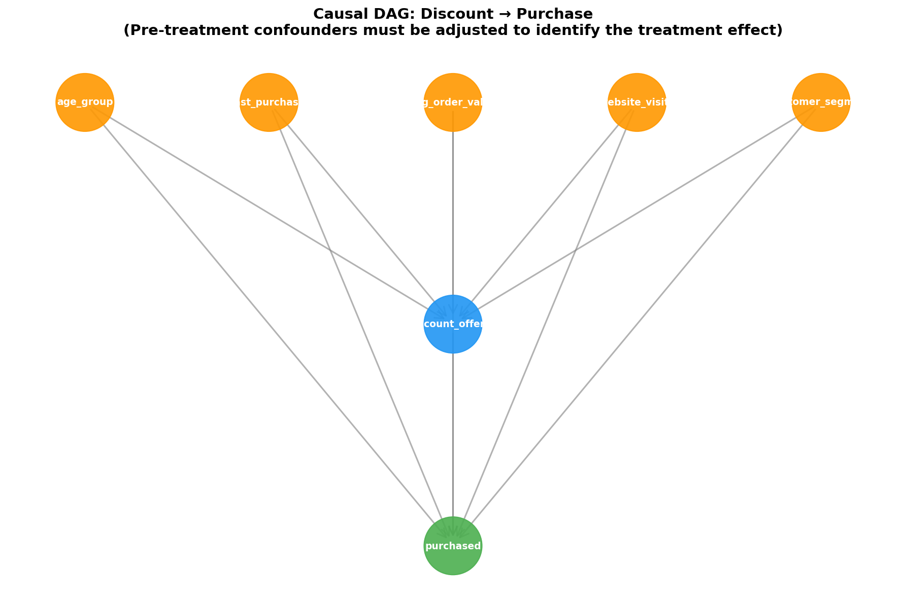

# EconoCausal — Week 1 Causal Analysis Report

**Project:** EconoCausal: Dynamic Pricing via Double Machine Learning  
**Reference:** ITS/DSML/1147  
**Date:** 2026-10-10  
**DoWhy version:** 0.14  

---

## 1. Causal Question

**Does offering a promotional discount cause an increase in purchase probability?**

More formally:

> What is the **Average Treatment Effect (ATE)** of `discount_offered` on `purchased`,
> adjusting for pre-treatment confounders?

Let:
- *T* = `discount_offered` (binary: 0 = control, 1 = treated)
- *Y* = `purchased` (binary: 0 = did not purchase, 1 = purchased)
- *X* = vector of pre-treatment covariates (confounders)

The causal estimand is:

$$
\tau = \mathbb{E}[Y(1) - Y(0)]
$$

where *Y(1)* and *Y(0)* are the potential outcomes under treatment and control.

---

## 2. Causal Graph (DAG)

### Graph Structure

- **Treatment node:** `discount_offered`
- **Outcome node:** `purchased`
- **Common causes (confounders):**
  - `age_group`
  - `past_purchases`
  - `avg_order_value`
  - `website_visits`
  - `customer_segment`

Each confounder has a directed edge to both the treatment and the outcome,
representing that these variables influence:
1. **Which customers are offered a discount** (treatment propensity).
2. **Whether a customer purchases** (baseline outcome probability).

The treatment node has a directed edge to the outcome, representing the
hypothesised causal effect we wish to estimate.

---

## 3. Identification Assumptions

To interpret an estimated treatment effect as causal, the following
assumptions must hold:

### 3.1 Consistency (SUTVA — Stable Unit Treatment Value Assumption)

- The potential outcome *Y(t)* is well-defined for each customer.
- One customer's treatment does not affect another customer's outcome
  (no interference).
- There is only one version of the treatment (e.g., all discounts are
  equivalent in mechanism).

**Assessment for this dataset:**  
Plausible if customers do not influence each other's purchase decisions.
Violations may occur if discounts trigger social sharing or competitive effects.

### 3.2 Positivity (Overlap)

- Every customer has a non-zero probability of receiving both treatment
  and control:

$$
0 < P(T=1 \mid X=x) < 1 \quad \forall x \in \text{support}(X)
$$

**Assessment:**  
Week 1 EDA (Figure 8) shows overlap in confounder distributions between
treated and control groups. Propensity scores will be checked in Week 2.

### 3.3 Conditional Exchangeability (Unconfoundedness, Ignorability)

- Treatment assignment is independent of potential outcomes, conditional
  on the observed covariates *X*:

$$
\{Y(0), Y(1)\} \perp T \mid X
$$

This assumption requires that **all common causes of treatment and outcome
are observed and included in *X*.** Unmeasured confounding violates this
assumption and biases the estimate.

**Assessment:**  
The five confounders listed above were selected based on:
1. Temporal precedence: all are measured before the campaign.
2. Plausibility: customer history, engagement, and segment logically
   influence both targeting decisions and purchase propensity.

**Limitation:**  
We cannot rule out unmeasured confounders such as:
- Brand affinity or loyalty not captured by `past_purchases`.
- External promotions or seasonal effects not recorded.
- Latent customer preferences.

Sensitivity analyses (e.g., refutation tests in DoWhy) and domain
knowledge reviews are recommended.

---

## 4. Variable Roles and Exclusions

### Included in the Adjustment Set (Confounders)

| Variable | Rationale |
|----------|----------|
| `age_group` | Demographic segment; may affect targeting and purchase behaviour. |
| `past_purchases` | Strong predictor of both treatment propensity and outcome. |
| `avg_order_value` | Spending capacity; correlated with treatment and baseline purchase rate. |
| `website_visits` | Engagement proxy; affects targeting and purchase likelihood. |
| `customer_segment` | CRM-assigned segment (Premium/Regular/Occasional/Lapsed); confounds both treatment and outcome. |

### Excluded from the Adjustment Set

| Variable | Reason for exclusion |
|----------|----------------------|
| `customer_id` | Unique identifier with no causal meaning. Including it would create spurious one-to-one mappings. |
| `discount_amount` | Determined **after** treatment assignment; it is a treatment attribute, not a pre-treatment confounder. |
| `revenue` | **Post-treatment variable.** Measured after the campaign window. Conditioning on a post-treatment variable opens collider paths and introduces bias. Use `revenue` as an alternative outcome, not a covariate. |
| `campaign_date` | Administrative timestamp with no causal relationship to the outcome. |
| `is_outlier` | Data-quality flag, not a pre-treatment causal variable. |

---

## 5. Causal Concepts Summary

### Confounders
Variables that influence both treatment and outcome. Failing to adjust for
confounders biases the treatment-effect estimate.

### Mediators
Variables on the causal path between treatment and outcome (e.g., if the
discount changes customer engagement, which then changes purchase). Do **not**
condition on mediators when estimating the **total treatment effect**.

### Colliders
Variables caused by both treatment and outcome, or by variables on separate
causal paths. Conditioning on a collider opens spurious associations and
biases the estimate.

**Example in this dataset:**  
`revenue` is a post-treatment variable determined by both `discount_offered`
(treatment) and `purchased` (outcome). Conditioning on it introduces collider
bias.

---

## 6. Identification Strategy

Given the DAG and assumptions, the causal effect is identified by:

1. **Conditioning on the adjustment set** (backdoor criterion satisfied).
2. Estimating:

$$
\tau = \mathbb{E}_X \left[ \mathbb{E}[Y \mid T=1, X] - \mathbb{E}[Y \mid T=0, X] \right]
$$

In Week 2, we will estimate this using **Double Machine Learning (DML)**,
which uses flexible machine-learning models to estimate the conditional
expectations *m(X) = E[Y|X]* and *e(X) = E[T|X]*, then constructs an
orthogonalised moment condition to reduce bias from model misspecification.

---

## 7. Limitations and Caveats

1. **Unmeasured confounding:**  
   The conditional exchangeability assumption is untestable. Sensitivity
   analyses can quantify how strong an unmeasured confounder would need to
   be to overturn the conclusion.

2. **Data quality:**  
   This analysis uses synthetic data. Real-world data may have additional
   confounders, measurement error, and selection issues.

3. **Generalisability:**  
   The estimated effect applies to the observed sample and time period.
   External validity (whether the effect holds in other populations or
   contexts) requires additional evidence.

4. **Treatment definition:**  
   All discounts are treated as a single binary intervention. Heterogeneity
   in discount amounts or mechanisms is not modelled here.

---

## 8. Next Steps

- **Week 2:** Fit a DML estimator (EconML `LinearDML` or `CausalForestDML`)
  using the identified adjustment set.
- Estimate the ATE and Conditional ATE (CATE) by customer segment.
- Check propensity overlap and perform refutation tests.
- Compare the adjusted estimate with the naïve difference from Week 1 EDA.

---

*Generated by `src/causal/build_dag.py` — EconoCausal Week 1*
