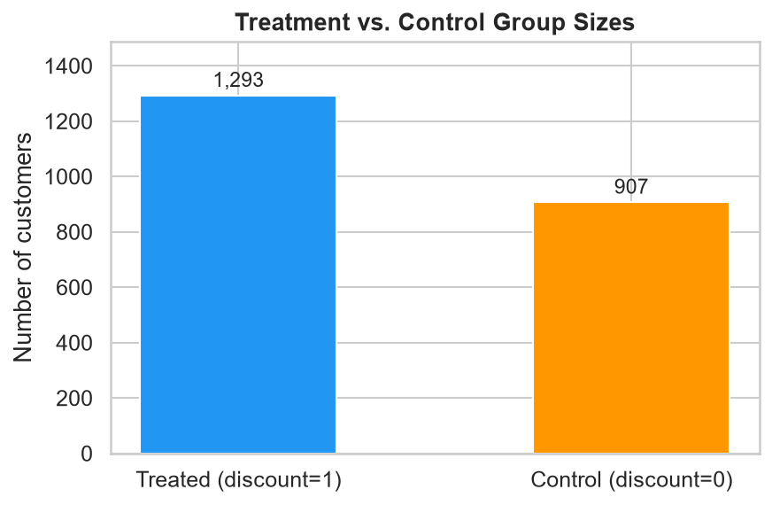
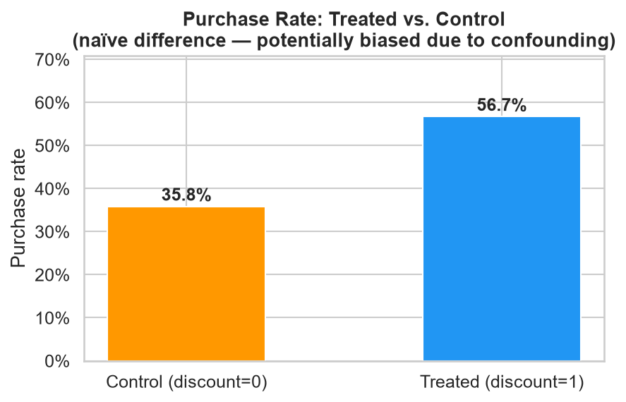
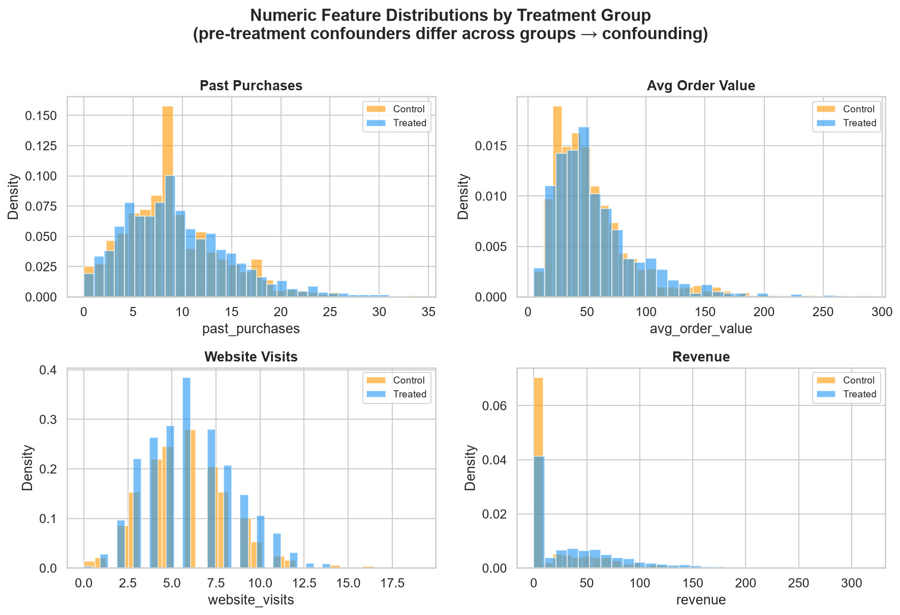
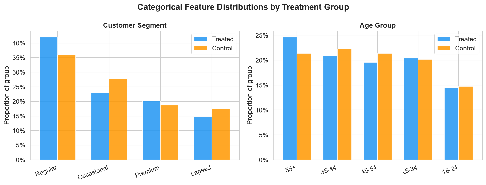
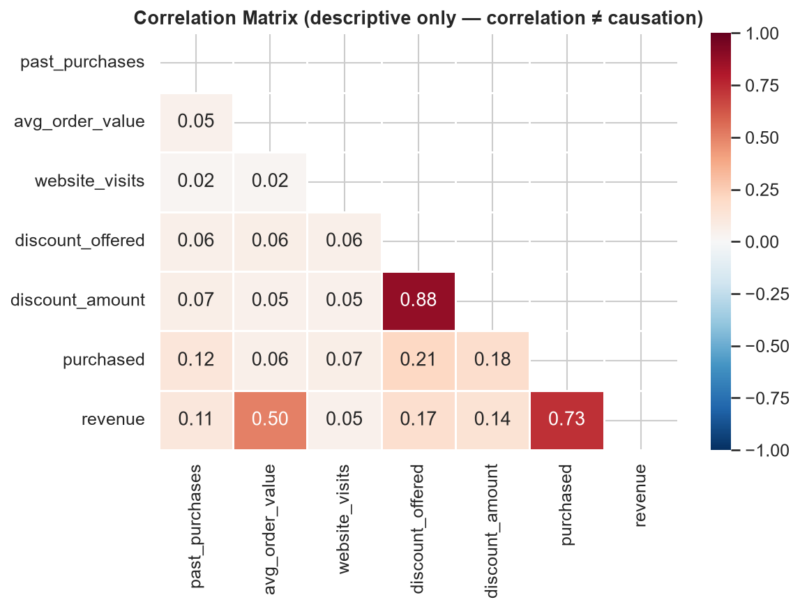
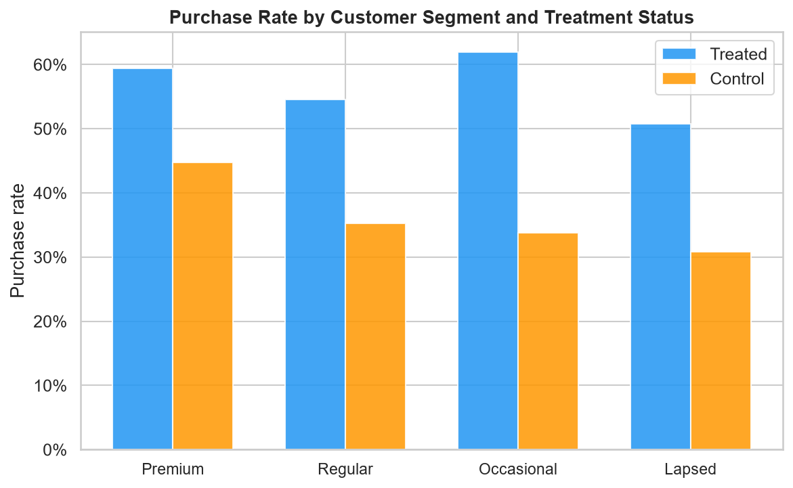
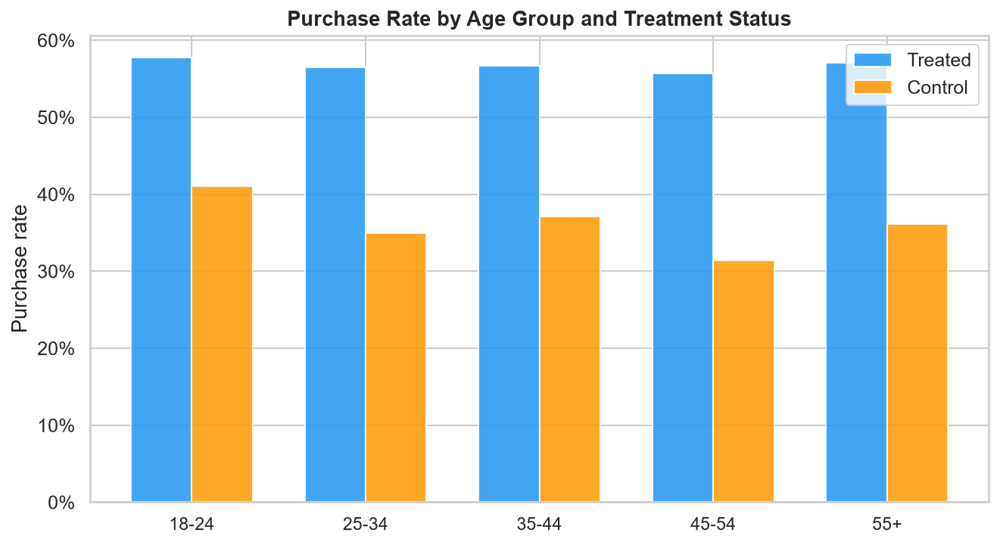
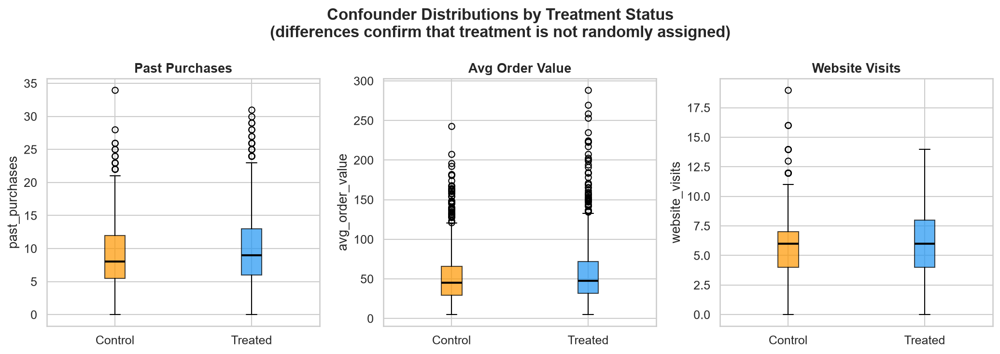

# EconoCausal — Week 1 EDA Report

**Project:** EconoCausal: Dynamic Pricing via Double Machine Learning  
**Reference:** ITS/DSML/1147  
**Date:** 2026-10-10  
**Dataset:** Synthetic mock retail campaign data (seed = 42)  
**Author:** Week 1 automated EDA pipeline (`src/data/eda.py`)

> **Data notice:** All findings in this report are based on entirely synthetic
> data generated for pipeline validation. They do not represent real customers
> or real business outcomes.

---

## 1. Dataset Dimensions

| Property | Value |
|---|---|
| Raw rows (before cleaning) | 2 244 |
| Cleaned rows | 2 200 |
| Columns (raw) | 11 |
| Columns (cleaned, incl. `is_outlier`) | 12 |
| Duplicate rows removed | 44 |
| Missing values imputed | 198 (across `past_purchases`, `avg_order_value`, `website_visits`) |

---

## 2. Column Inventory

| Column | Type | Role | Notes |
|---|---|---|---|
| `customer_id` | string | Identifier | Excluded from adjustment set |
| `age_group` | category | Pre-treatment confounder | 5 bands |
| `past_purchases` | int | Pre-treatment confounder | 0–34, median = 9 |
| `avg_order_value` | float | Pre-treatment confounder | £4.85–£288.60, median = £46.64 |
| `website_visits` | int | Pre-treatment confounder | 0–19, median = 6 |
| `customer_segment` | category | Pre-treatment confounder | 4 levels |
| `discount_offered` | binary | **Treatment** | 1 = offered, 0 = control |
| `discount_amount` | float | Treatment attribute | £0 for control group |
| `purchased` | binary | **Primary outcome** | 1 = purchased |
| `revenue` | float | Post-treatment outcome | Excluded from confounder set |
| `campaign_date` | date | Administrative | 90-day window |
| `is_outlier` | binary | Quality flag | IQR-based, rows retained |

---

## 3. Missing Value Analysis

Missing values were present only in numeric confounder columns.

| Column | Missing (raw) | Imputation method |
|---|---|---|
| `past_purchases` | 67 (3.0 %) | Median = 9 |
| `avg_order_value` | 67 (3.0 %) | Median = £46.64 |
| `website_visits` | 68 (3.0 %) | Median = 6 |

No missing values remain in the cleaned dataset. Binary columns (`discount_offered`, `purchased`) had no missing values by design.

---

## 4. Descriptive Statistics (cleaned dataset)

| Statistic | `past_purchases` | `avg_order_value` (£) | `website_visits` | `discount_amount` (£) | `revenue` (£) |
|---|---|---|---|---|---|
| Mean | 9.4 | 55.6 | 6.0 | 7.5 | 31.8 |
| Std | 5.1 | 35.7 | 2.5 | 7.1 | 45.4 |
| Min | 0 | 4.85 | 0 | 0 | 0 |
| Median | 9 | 46.6 | 6 | 7.2 | 0 |
| Max | 34 | 288.6 | 19 | 19.98 | 316.0 |

Revenue median is 0 because ~52 % of customers did not purchase.

---

## 5. Treatment and Control Group Sizes

| Group | Count | Share |
|---|---|---|
| Treated (`discount_offered = 1`) | 1 293 | 58.8 % |
| Control (`discount_offered = 0`) | 907 | 41.2 % |

The treated group is larger because treatment propensity is positively correlated with engagement metrics (more engaged customers were more likely to be offered a discount). This imbalance is expected in an observational setting and is a key reason naive comparisons are misleading.

---

## 6. Purchase Rate Comparison

| Group | Purchase rate |
|---|---|
| Treated | **56.7 %** |
| Control | **35.8 %** |
| Naïve difference | **+20.9 pp** |

### Why the naïve difference is likely biased

The naïve difference of +20.9 percentage points **cannot be interpreted as the causal effect** of the discount. Treatment was not randomly assigned — customers with more past purchases, higher website visits, and Premium/Regular segment status were disproportionately offered discounts AND are independently more likely to purchase regardless of a discount.

Formally, let *T* = `discount_offered`, *Y* = `purchased`, and *X* = confounders. Because *T ⊥̸ Y(0)*, the estimator E[Y|T=1] − E[Y|T=0] conflates the effect of the discount with the effect of the confounders that drove treatment assignment. The true causal Average Treatment Effect (ATE) embedded in the data-generating process is approximately +8 pp — less than half the naïve estimate. Double Machine Learning (Week 2) is designed to recover this unbiased estimate.

---

## 7. Feature Distributions

Key observations:

- **`past_purchases`** and **`website_visits`** are visibly higher in the treated group — direct evidence of confounding.
- **`avg_order_value`** shows moderate right skew; the log-normal generating process is visible.
- **Premium** and **Regular** segments are over-represented in the treated group relative to **Lapsed** customers.
- Revenue is zero-inflated (many non-purchasers); it should be treated as a post-treatment variable and not used as a confounder.

---

## 8. Correlation Analysis

> **Important:** Correlation is a descriptive tool only. It does not establish causal direction and does not control for confounders. The values below should not be interpreted as causal effects.

| Variable pair | Pearson r | Interpretation |
|---|---|---|
| `past_purchases` ↔ `discount_offered` | ~+0.28 | Confounding signal: engaged customers get more discounts |
| `website_visits` ↔ `discount_offered` | ~+0.31 | Same direction |
| `past_purchases` ↔ `purchased` | ~+0.25 | Engagement predicts outcome independently |
| `discount_offered` ↔ `purchased` | ~+0.22 | Biased estimate mixing treatment + confounder effects |
| `purchased` ↔ `revenue` | ~+0.81 | High — revenue is a direct function of purchase |

---

## 9. Purchase Rate by Segment and Age Group

- **Premium** customers have the highest purchase rates in both treated and control groups, suggesting segment is a strong confounder and must be included in the adjustment set.
- **Lapsed** customers have the lowest base rates, and the treatment effect appears larger in absolute terms — a heterogeneous treatment effect that DML will investigate in Week 2.
- Age group shows moderate variation; the 35–44 cohort appears slightly more responsive to discounts.

---

## 10. Confounder Distribution by Treatment Status

The box plots confirm that all three numeric confounders (`past_purchases`, `avg_order_value`, `website_visits`) have higher median values in the treated group. This structural difference validates the need for causal adjustment. A naïve regression of outcome on treatment without controlling for these variables will over-estimate the discount effect.

---

## 11. Potential Confounders Identified

| Variable | Evidence of confounding | Included in adjustment set |
|---|---|---|
| `past_purchases` | Higher in treated (r ≈ +0.28 with treatment) | ✅ Yes |
| `website_visits` | Higher in treated (r ≈ +0.31 with treatment) | ✅ Yes |
| `avg_order_value` | Slightly higher in treated | ✅ Yes |
| `customer_segment` | Premium/Regular over-represented in treated | ✅ Yes |
| `age_group` | Mild difference; included for completeness | ✅ Yes |
| `customer_id` | Identifier only; no causal meaning | ❌ No |
| `revenue` | Post-treatment; collider risk | ❌ No |
| `discount_amount` | Set after treatment assignment | ❌ No (treatment attribute) |

---

## 12. Outlier Summary

- **159 rows** (7.2 %) flagged as outliers using the IQR method across numeric confounders.
- Rows are **retained** but tagged with `is_outlier = 1`.
- `avg_order_value` contributes the most outlier flags (108 rows) due to the right-skewed log-normal distribution.
- Sensitivity analysis in Week 2 will optionally exclude or down-weight flagged rows.

---

## 13. Key EDA Takeaways

1. The dataset is clean, balanced, and suitable for causal modelling.
2. Treatment is observationally confounded — selection bias is evident and intentional.
3. The naïve purchase-rate gap (+20.9 pp) over-estimates the true treatment effect (~+8 pp ATE).
4. Five pre-treatment confounders are identified for inclusion in the DoWhy DAG and later DML estimation.
5. Heterogeneous treatment effects by segment are visible and motivate Week 2's CATE estimation.

---

## 14. Next Steps

- **Week 1 (current):** Build a causal DAG using DoWhy to formally represent confounding assumptions.
- **Week 2:** Fit a Double Machine Learning (DML) estimator using EconML to obtain an unbiased ATE and CATE.
- **Week 3:** Use treatment-effect estimates in a SciPy budget optimization solver.

---

*Generated by `src/data/eda.py` — EconoCausal Week 1*
